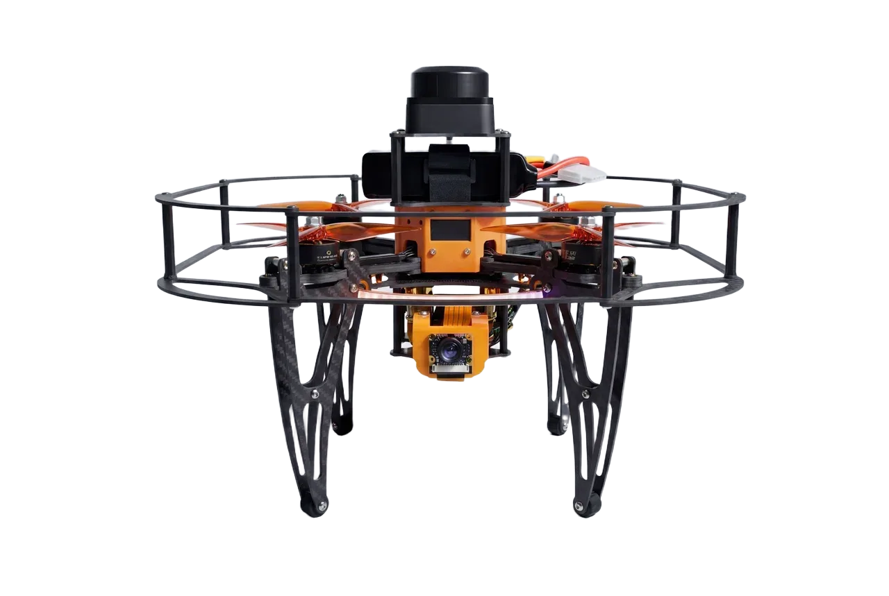
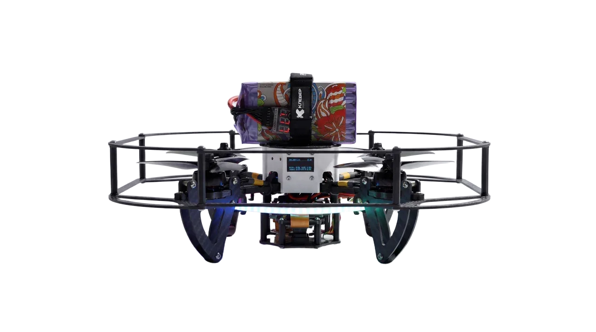
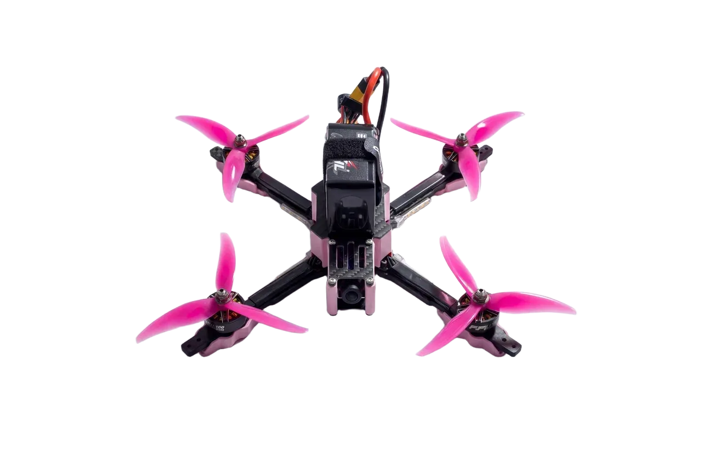
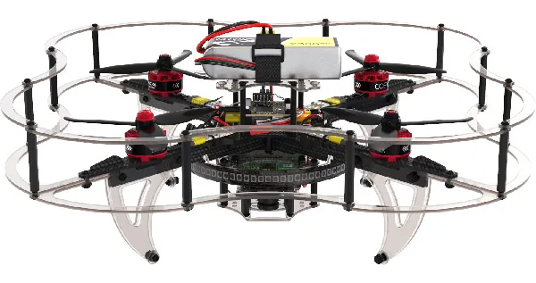

# Clover drone assembly

This section contains articles describing the assembly of each version of Clover.

<table class=versions>
     <tr><th>Version</th><th>Image</th></tr>
     <tr>
               <td><a href="assemble_5_dev.md">Clover&nbsp;5&nbsp;DEV</a></td>
               <td></td>
          </tr>
     <tr>
          <td><a href="assemble_5.md">Clover&nbsp;5&nbsp;CODE</a></td>
          <td></td>
     </tr>
     <tr>
          <td><a href="assemble_5_fpv.md">Clover&nbsp;5&nbsp;FPV</a></td>
          <td></td>
     </tr>
     <tr>
          <td>
               <a href="assemble_4_2_ws.md">Clover&nbsp;4 PRO</a>
          </td>
          <td></td>
     </tr>
     <tr>
          <td><a href="assemble_4_2.md">Clover&nbsp;4&nbsp;CODE</a></td>
          <td></td>
     </tr>
</table>

Links to Clover's parts CAD-models are available in the "[CAD-models](models.md)" article.
