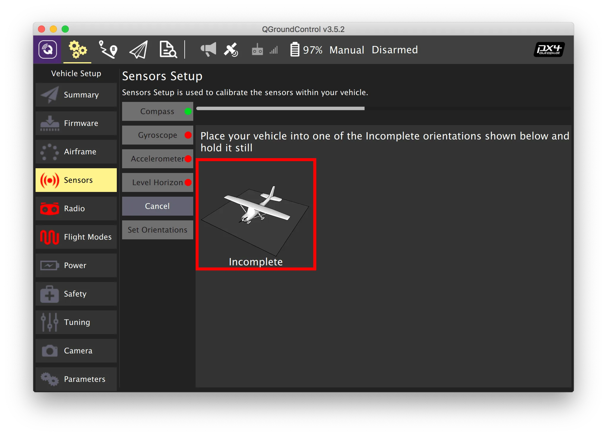
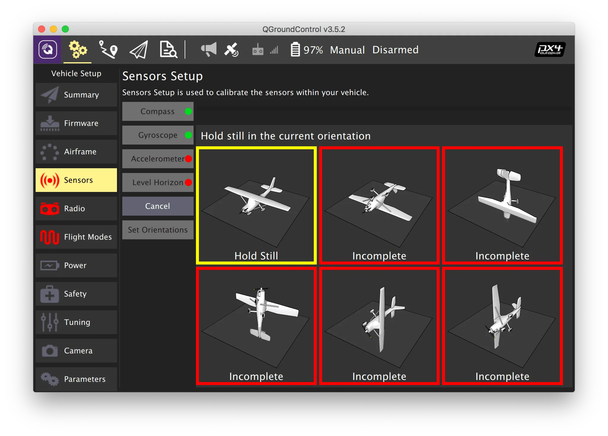
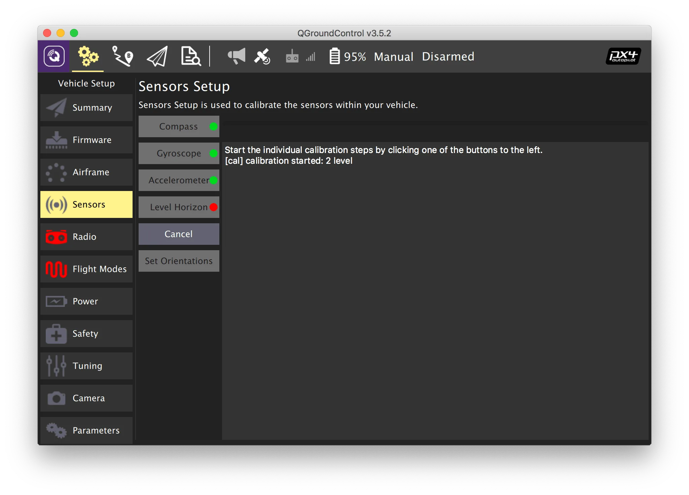

# Sensor calibration

To calibrate the sensors, go to the *Vehicle Setup* tab and select the *Sensors* menu.

## Gyroscope

1. Select the *Gyroscope* menu.
2. Place the quadcopter on a flat surface.
3. Press *OK*.
4. Wait for the calibration to complete.

> **Warning** During gyroscope calibration, the quadcopter must not change position, wobble, etc.

Additional information: [https://docs.px4.io/main/en/config/gyroscope.html](https://docs.px4.io/main/en/config/gyroscope.html).

## Accelerometer

1. Select the *Accelerometer* menu.
2. Select the flight controller orientation — *ROTATION_NONE* if the flight controller is oriented with its front towards the quadcopter's nose.
3. Sequentially place the quadcopter in each of the indicated orientations until the yellow frame appears.
4. Hold the quadcopter motionless until the green frame appears.

Additional information: [https://docs.px4.io/main/en/config/accelerometer.html](https://docs.px4.io/main/en/config/accelerometer.html).

## Level horizon

1. Select the *Level Horizon* menu.
2. Select the flight controller orientation — *ROTATION_NONE* if the flight controller is oriented with its front towards the quadcopter's nose.
3. Place the quadcopter on a flat surface.
4. Press *OK*.
5. Wait for the calibration to complete.

Additional information: [https://docs.px4.io/main/en/config/level_horizon_calibration.html](https://docs.px4.io/main/en/config/level_horizon_calibration.html).

**Next**: [RC setup](radio.md).
