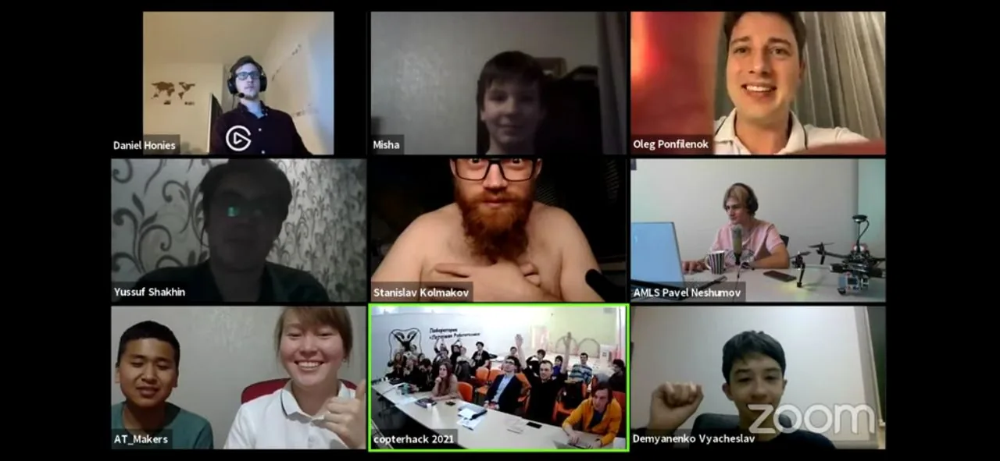
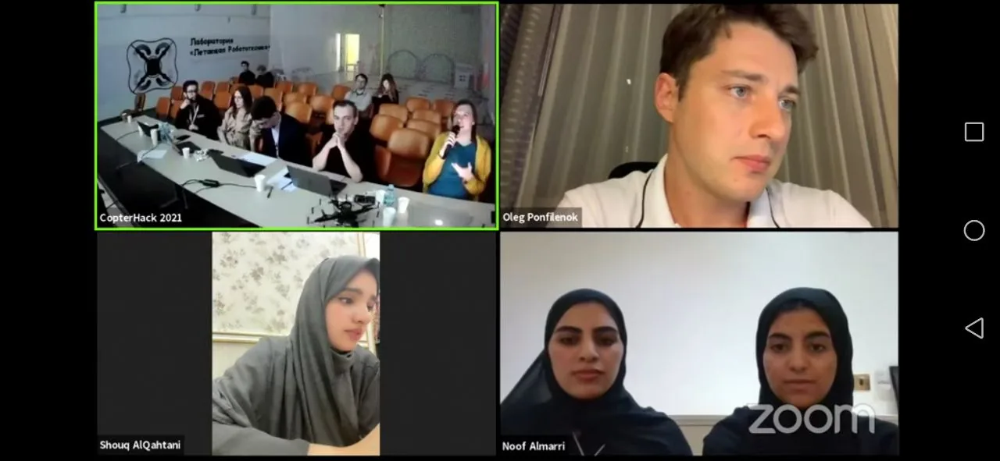

# CopterHack 2021

CopterHack 2021 is a team competition for the development of open source projects for the Clover quadcopter platform. Fifty-four teams from 12 countries took part in the competition.

All information about the event can be found on the official website: https://coex.tech/copterhack.

Full stream of the final: https://www.youtube.com/watch?v=Z06vxuAHmuE.

    
    

## Aftermovie

<iframe width="560" height="315" src="https://www.youtube.com/embed/YpMT6ab8Exw" frameborder="0" allow="accelerometer; autoplay; encrypted-media; gyroscope; picture-in-picture" allowfullscreen></iframe>

## Participating teams articles

|Place|Team|Project|Points|
|-|-|-|-|
|1|🇧🇾 FTL|[AdvancedClover](../ru/advanced_clover.html)|18.8|
|2|🇷🇺 EasyToFly|[EasyToFly](../ru/easytofly.html)|18.5|
|3|🇩🇪 ADDI|[3D-printed generative design frame](generative_design_frame.md)|17.8|
|4|🇰🇬 AT Makers|[D-drone Graffiti-copter](ddrone.md)|16.7|
|5|🇶🇦 DroMap|[The Indoor Mapping Drone](dromap.md)|16.5|
|6|🇰🇬 MINIONS|[Seed spreading quadcopter](seeding_drone.md)|15.5|
|7|🇷🇺 Hardaton|[Хардатон Квиддич](../ru/hardaton_quidditch.html)|15.48|
|8|🇷🇺 Atomic Ferrets|[Система засечки для дронов](../ru/race_timing_sys_copterhack.html)|15|
|9|🇷🇺 Drones to fight Corona|[Drones to fight Corona](anticorona_drones.md)|14.6|
|10|🇷🇺 AMLS|[Autonomous Multirotor Landing System](amls.md)|12.8|
|11|🇷🇺 PаD30DЖ|[Октокоптер со специфичным расположением пропеллеров](../ru/oktazodg.html)|11.6|
|12|🇷🇺 Zaural Viking|[Программируемый летающий автомобиль](../ru/zaural_viking.html)|11.4|
|13|🇨🇦 Bennie and the Jetson TX2|[Retail Drone](bennie.md)|9.8|
|14|🇳🇱 Blue Jay Eindhoven|[Designing a drone and a path planning algorithm](blue_jay_eindhoven.md)|9.6|
|15|🇷🇺 ProCleVeR|[Разработка системы для управления БПЛА с помощью шлема виртуальной реальности](../ru/remote-control-with-oculusvr.html)|8.5|
|16|🇷🇺 Quadrotor|[Дрон-Агроном](../ru/drone-agronom.html)|7.7|

See points by criteria in the [full table](https://docs.google.com/spreadsheets/d/1L9NDrw4c4vTCIVR3aC8ErAjxnuBg-Afil9AwUQZVJ5I/edit?usp=sharing).
