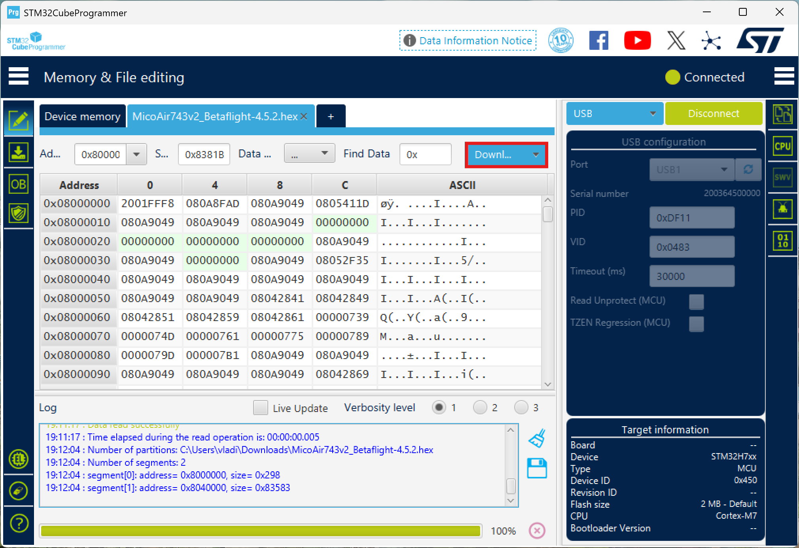
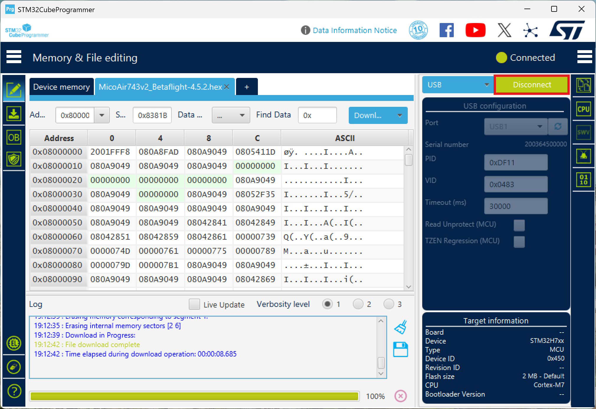
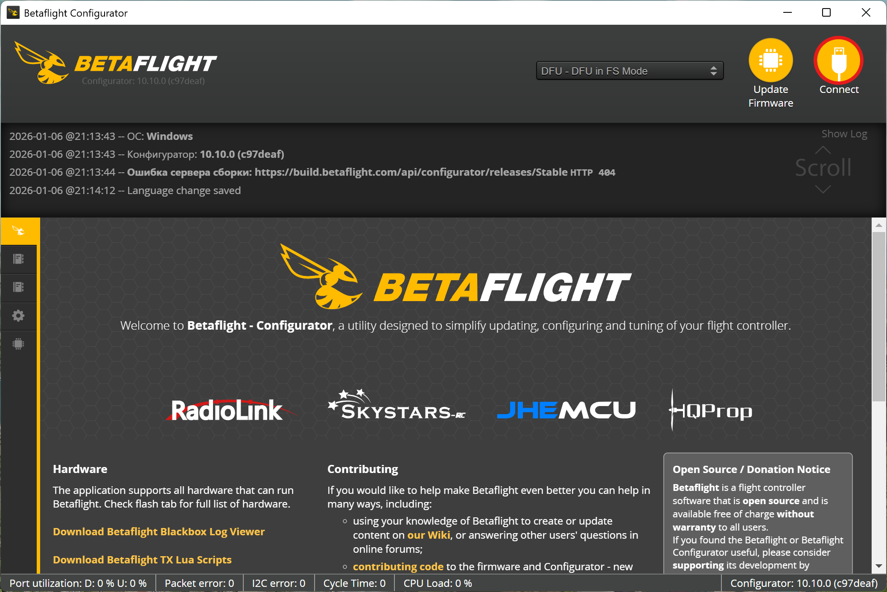

# Flashing MicoAir743v2 from PX4 to Betaflight

> **Success** This doc walks you through a safe way to re-flash the **MicoAir743v2** flight controller between PX4 and Betaflight via DFU/bootloader.  
> [How to flash from Betaflight to PX4](firmware_PX4_MicoAir743v2.md)

> **Caution** This guide is **ONLY** for the **MicoAir743v2** flight controller.  
> If you’ve got a **Pixracer / COEX Pix / Pixhawk**, use the Pixracer PX4 flashing guide instead:  
> [PX4 firmware on Pixracer](firmware_Pixracer.md)

  
   
  MicoAir743v2 flight controller

## Contents
1. [Software & firmware links](#software--firmware-links)
2. [Entering DFU / bootloader mode](#entering-dfu--bootloader-mode)
3. [Flashing PX4 to Betaflight](#flashing-px4-to-betaflight)

## Software & firmware links

- **Betaflight Configurator** (official releases): [github.com/betaflight/betaflight-configurator/releases](https://github.com/betaflight/betaflight-configurator/releases)
- **STM32CubeProgrammer** (Google Drive): [drive.google.com (STM32CubeProgrammer)](https://drive.google.com/file/d/1Iku7s-Pmpvm8ctj7OK7KDgX6tYp3GB6a/view?usp=drive_link)
- **Betaflight firmware** for MicoAir743v2: [drive.google.com (Betaflight firmware)](https://drive.google.com/file/d/1gaLgiCqa-gUa-vJtmGSQhVh7zwCFcqFN/view?usp=drive_link)

## Entering DFU / bootloader mode

1. Hold the **BOOT** button on the FC.
2. While holding **BOOT**, plug the USB cable into your PC.
3. Your system should detect it as **DFU / STM32 Bootloader**.

## Flashing PX4 to Betaflight

> **Caution** **Programmer setup (STM32CubeProgrammer)**  
> Before flashing, download and install STM32CubeProgrammer.

1. Put the flight controller into **DFU** (hold **BOOT** and plug it in via USB). Open STM32CubeProgrammer and click the connection protocol selector (UART).
    

2. Select the **USB** protocol.
    

3. Refresh ports (click the button to the right of the port selector). It should auto-pick the right one.  
If it doesn’t, the FC is not in DFU mode — redo step 1.
    

4. Click "Connect".
    

5. Do a full wipe: click the eraser icon in the bottom-left, confirm in the popup, and wait until it’s done.
    

6. Click **Open file** and select `MicoAir743v2_Betaflight-4.5.2.hex`.
    

7. Click "Download" to flash the firmware and wait until it finishes.
    

8. Click "Disconnect".
    

9. Open Betaflight Configurator and start setting things up.
    

