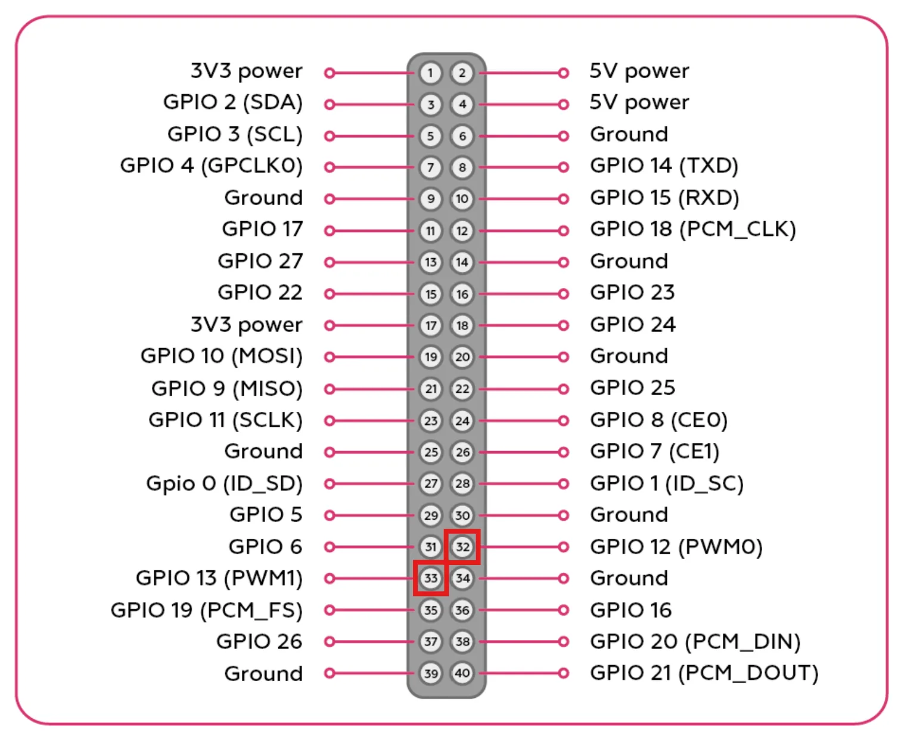

# Working with GPIO on Raspberry Pi 5

## Contents
1. [Digital input and output with gpiozero](#digital-input-and-output-with-gpiozero)
2. [Hardware PWM on Raspberry Pi 5](#hardware-pwm-on-raspberry-pi-5)
3. [Connecting and controlling a servo](#connecting-and-controlling-a-servo)

GPIO (General-Purpose Input/Output) is a type of pin whose voltage level can be controlled in software. On Raspberry Pi 5, some GPIO pins support hardware <abbr title="Pulse-width modulation">PWM</abbr>, which is convenient to control through the `rpi_hardware_pwm` library.

> **Note** Use the [pinout diagram](https://pinout.xyz) to see which pins on Raspberry Pi 5 support GPIO and hardware PWM.

<div align="center"><p>Figure 1 - Raspberry Pi pinout diagram</p></div>

> **Success** Unlike the article [Working with GPIO](gpio.md), this page covers GPIO on Raspberry Pi 5. For digital input and output, it is convenient to use the `gpiozero` library, and for hardware PWM on supported pins, use `rpi_hardware_pwm`.

## Digital input and output with gpiozero

For digital input and output on Raspberry Pi 5, it is convenient to use the `gpiozero` library. It works well when you need to turn a load on or off, read the state of a pin, or handle a button press.

> **Info** The examples below use GPIO pin numbers, not the physical pin numbers on the Raspberry Pi header.

Install the `lgpio` and `gpiozero` libraries:

```bash
sudo apt update
sudo apt install python3-lgpio python3-gpiozero
```

Example using the `gpiozero` library:

```python
from time import sleep
from gpiozero import InputDevice, OutputDevice

# Create an object for working with the output on GPIO17
out_pin = OutputDevice(17)

# Create an object for reading the state of GPIO27
in_pin = InputDevice(27)


# Apply a signal to GPIO17
out_pin.on()
sleep(2)

# Disable the signal on GPIO17
out_pin.off()

# Read the state of GPIO27
level = in_pin.value
print(f"Input level: {level}")
```

## Hardware PWM on Raspberry Pi 5

The `rpi_hardware_pwm` library works only with Raspberry Pi hardware PWM channels.

On Raspberry Pi 5, you can use the following GPIO pin numbers:

| GPIO | Physical pin | `HardwarePWM` channel |
| --- | --- | --- |
| GPIO12 | 32 | 0 |
| GPIO13 | 33 | 1 |

## Connecting and controlling a servo

A servo is usually controlled by a signal with a frequency of 50 Hz. In most cases, the control signal for a servo has a range from 1000 to 2000 us.

* `1000` us - initial position
* `1500` us - middle position
* `2000` us - final position

Connect:

* the servo signal wire to `GPIO13`
* the servo power line to an external 5 V supply or through a BEC
* the external power ground must be connected to Raspberry Pi `GND`

Example code for controlling a servo:

```python
from rpi_hardware_pwm import HardwarePWM
import time


# The servo control frequency is usually 50 Hz
SERVO_PWM_HZ = 50

# DUTY is the PWM duty cycle in percent
# At 50 Hz, the period is 20 ms:
# 0.5 ms -> 2.5%
# 1.5 ms -> 7.5%
# 2.5 ms -> 12.5%
# These pulses usually correspond to 0°, 90°, and 180°.
DUTY_0 = 2.5
DUTY_90 = 7.5
DUTY_180 = 12.5

# Create an object for working with hardware PWM on GPIO13 (PWM1)
pwm = HardwarePWM(pwm_channel=1, hz=SERVO_PWM_HZ, chip=0)


def set_servo_angle(duty_cycle):
    # Apply a new value to the PWM signal
    duty_cycle = max(DUTY_0, min(DUTY_180, duty_cycle))
    pwm.change_duty_cycle(duty_cycle)


def servo_demo(wait_s=2):
    try:
        # Start PWM and immediately move the servo to the 0° position
        pwm.start(DUTY_0)
        time.sleep(1)

        print("0°")
        set_servo_angle(DUTY_0)
        time.sleep(wait_s)

        # Move the servo to 90°
        print("90°")
        set_servo_angle(DUTY_90)
        time.sleep(wait_s)

        # Move the servo to 180°
        print("180°")
        set_servo_angle(DUTY_180)
        time.sleep(wait_s)
    finally:
        # Disable PWM when stopping explicitly
        pwm.stop()


if __name__ == "__main__":
    servo_demo()
```

> **Note** After calling `pwm.stop()`, the control signal disappears, so the gearbox stops holding the position and may change its position.
