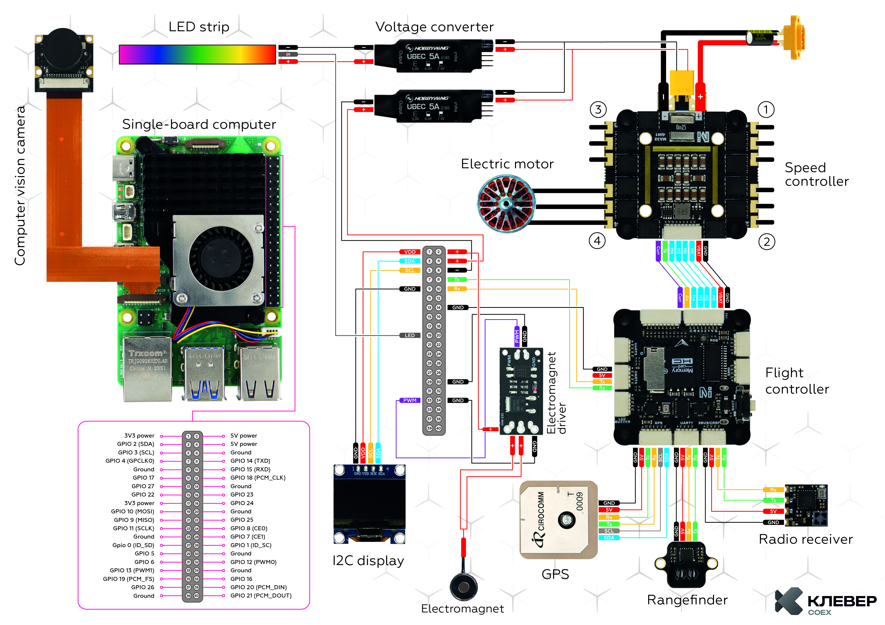
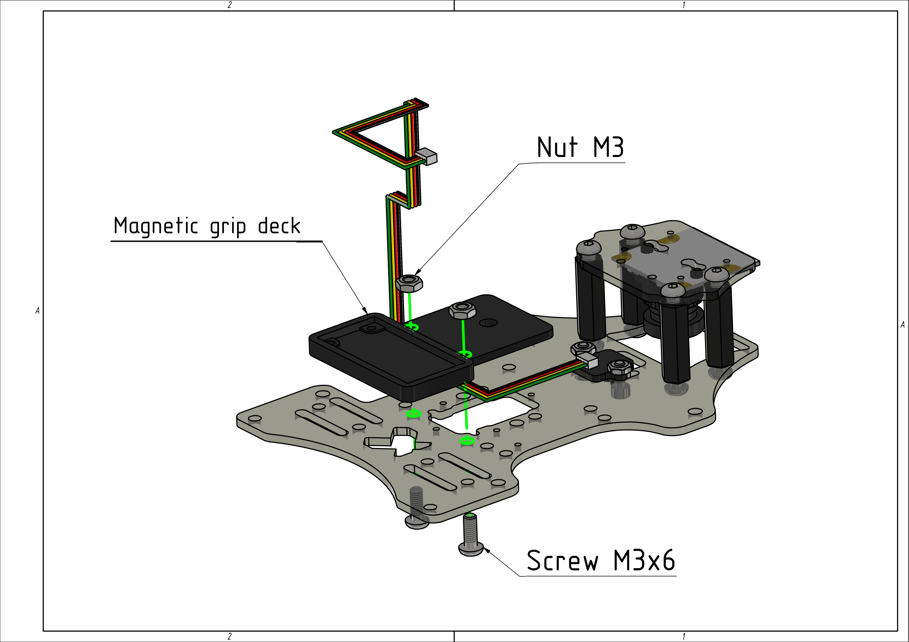
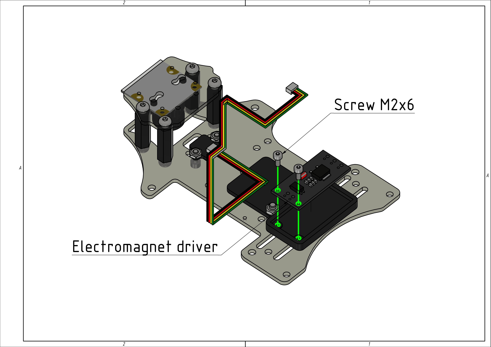
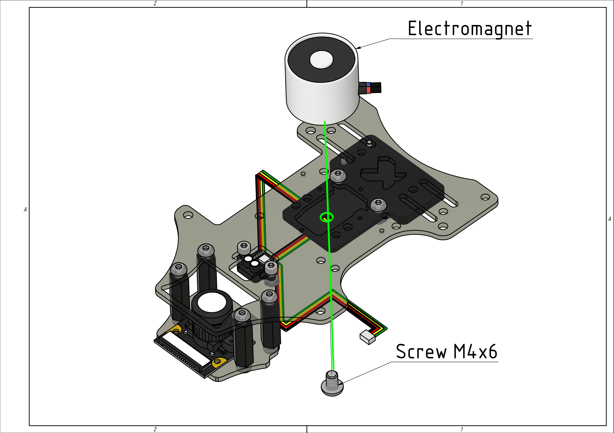
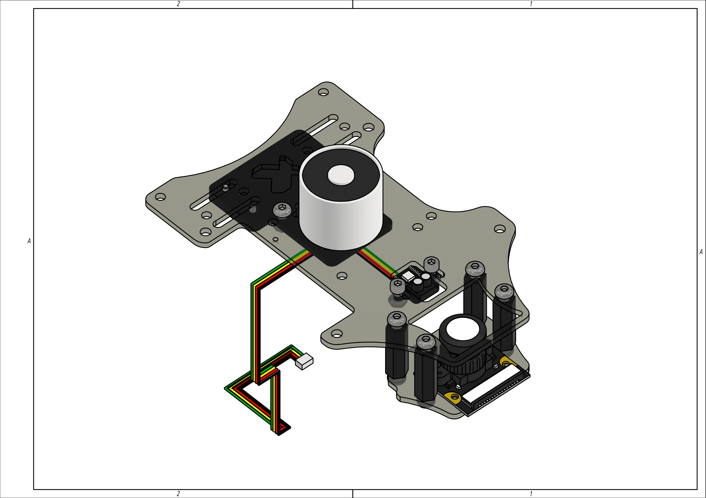
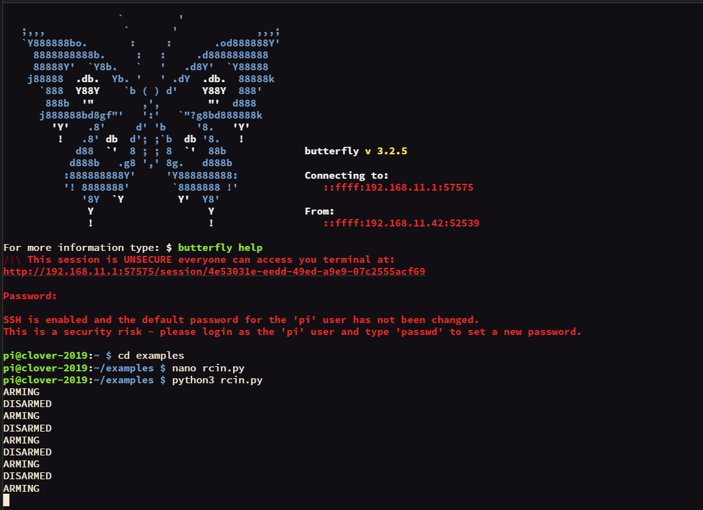
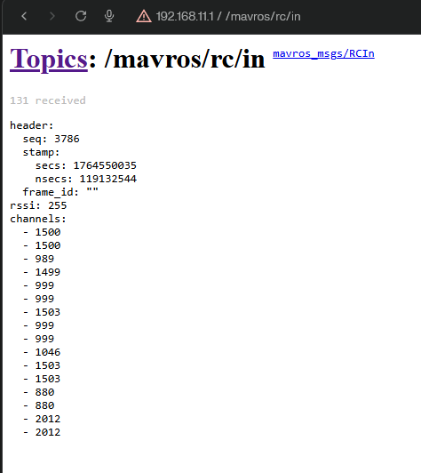

# Working with Magnetic Gripper

## Contents
1. [Module Assembly and Installation](#module-assembly-and-installation)
2. [Testing the Setup](#testing-the-setup)
3. [Controlling the Magnetic Gripper via RC Transmitter](#controlling-the-magnetic-gripper-via-rc-transmitter)
   - [Reading RC Channel Values](#reading-rc-channel-values)
   - [Magnetic Gripper Control Code Examples](#magnetic-gripper-control-code-examples)

## Module Assembly and Installation

1. Solder the magnetic gripper module according to the wiring diagram. The wire ends should have Dupont female connectors (wire length ~10-15cm).

    <div align="center"></div>

    <div align="center"><em>Electronics wiring diagram</em></div>

2. Mount the magnetic gripper deck using M3x6 screws and M3 nuts.

    <div align="center"></div>

3. Install the electromagnet module onto the gripper deck using M2x6 screws.

    <div align="center"></div>

4. Attach the electromagnet to the gripper deck using an M4x6 screw.

    <div align="center"></div>

5. Assembled magnetic gripper.

    <div align="center"></div>

6. Connect the magnetic gripper to Raspberry Pi according to the electronics wiring diagram (see step 1).

## Testing the Setup

Upload the sample code to test the magnetic gripper functionality.

```python
from rpi_hardware_pwm import HardwarePWM
import time


# pwmchip0, channel 1
pwm = HardwarePWM(pwm_channel=1, hz=50, chip=0)


def control_magnet(on_time=2, off_time=2):
    try:
        pwm.start(0)
        while True:
            print("ON")
            pwm.change_duty_cycle(100)
            time.sleep(on_time)
            print("OFF")
            pwm.change_duty_cycle(0)
            time.sleep(off_time)
    finally:
        pwm.stop()


if __name__ == "__main__":
    control_magnet(on_time=2, off_time=2)
```

## Controlling the Magnetic Gripper via RC Transmitter

### Reading RC Channel Values

> For MAVROS topics documentation, see the [link](https://clover.coex.tech/en/mavros.html).

Sample code for reading channel values when toggling a switch:

```python
import rospy
from mavros_msgs.msg import RCIn


last_state = None


def rc_callback(data: RCIn):
    global last_state

    if len(data.channels) <= 6:
        return

    ch = data.channels[6]

    if ch < 1000:
        state = 'ARMING'
    elif ch > 1900:
        state = 'DISARMED'
    else:
        state = None

    if state is not None and state != last_state:
        print(state)
        last_state = state


def main():
    rospy.init_node('rc_reader')
    rospy.Subscriber('mavros/rc/in', RCIn, rc_callback)
    rospy.spin()


if __name__ == '__main__':
    main()
```

Example output in topic and terminal:
<div align="center">
    
    
</div>

### Magnetic Gripper Control Code Examples

Sample code for controlling the magnetic gripper via RC transmitter:

```python
import rospy
from mavros_msgs.msg import RCIn
from rpi_hardware_pwm import HardwarePWM


pwm = None
magnet_on = False


def rc_callback(data: RCIn):
    global magnet_on

    if 6 >= len(data.channels):
        return

    ch = data.channels[6]

    if ch < 1000 and magnet_on:
        rospy.loginfo("OFF")
        pwm.change_duty_cycle(0)
        magnet_on = False
    elif ch > 1900 and not magnet_on:
        rospy.loginfo("ON")
        pwm.change_duty_cycle(100)
        magnet_on = True


def main():
    global pwm

    rospy.init_node('magnet_rc')
    pwm = HardwarePWM(pwm_channel=1, hz=50, chip=0)
    pwm.start(0)
    rospy.Subscriber('mavros/rc/in', RCIn, rc_callback)
    rospy.loginfo("magnet_rc start")
    rospy.spin()
    pwm.stop()


if __name__ == '__main__':
    main()
```

Sample code for smooth payload pickup using a servo:

```python
import rospy
from mavros_msgs.msg import RCIn
from rpi_hardware_pwm import HardwarePWM

pwm = None

S1_INDEX = 8 

RC_MIN = 1000
RC_MAX = 2000

ANGLE_MIN = 0.0
ANGLE_MAX = 90.0

DUTY_MIN = 3
DUTY_MAX = 12

def rc_callback(msg: RCIn):
    if len(msg.channels) <= S1_INDEX:
        return

    ch = msg.channels[S1_INDEX]

    if ch < RC_MIN:
        ch = RC_MIN
    elif ch > RC_MAX:
        ch = RC_MAX

    k = float(ch - RC_MIN) / float(RC_MAX - RC_MIN)

    angle = ANGLE_MIN + (ANGLE_MAX - ANGLE_MIN) * k

    duty = DUTY_MIN + (DUTY_MAX - DUTY_MIN) * (angle / ANGLE_MAX)

    pwm.change_duty_cycle(duty)

def main():
    global pwm

    rospy.init_node('servo_from_slider')

    pwm = HardwarePWM(pwm_channel=1, hz=50, chip=0)
    pwm.start(DUTY_MIN)

    rospy.Subscriber('mavros/rc/in', RCIn, rc_callback)
    rospy.loginfo('servo_from_slider start')
    rospy.spin()

    pwm.stop()

if __name__ == '__main__':
    main()
```
