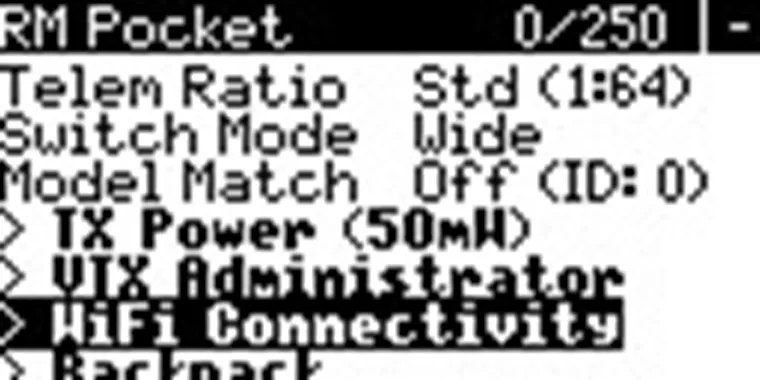
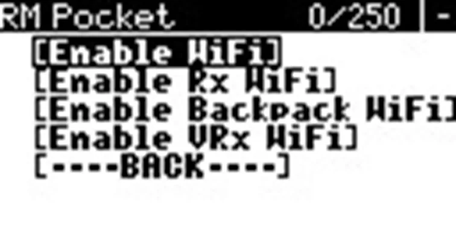
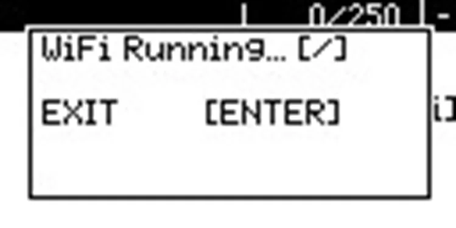
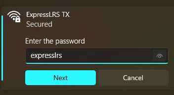
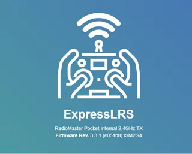
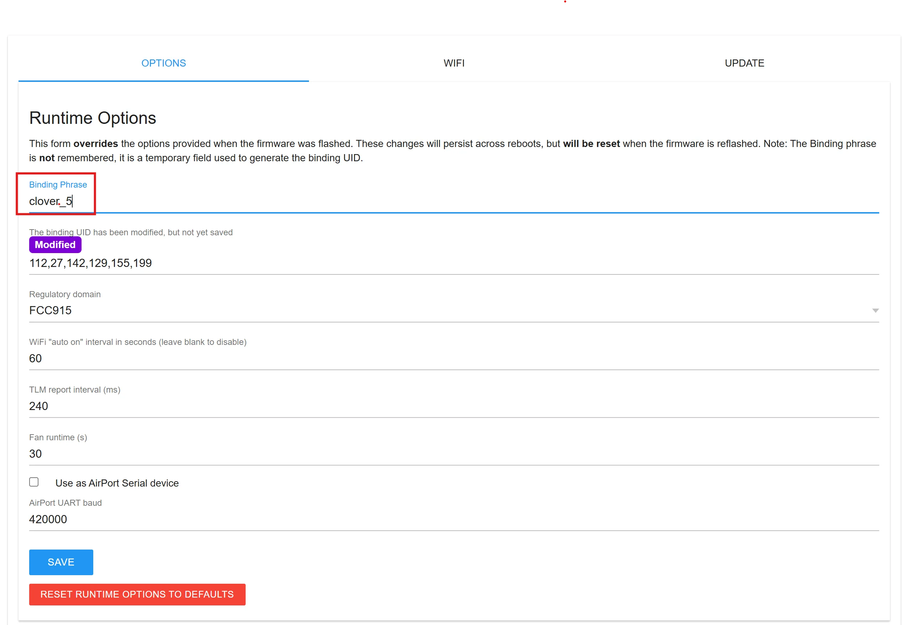
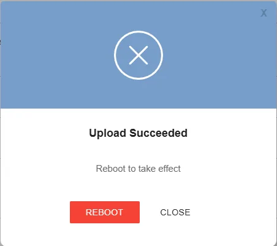
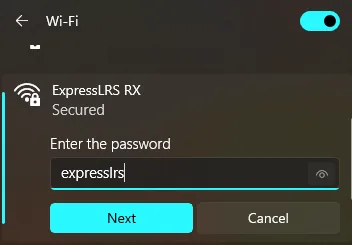
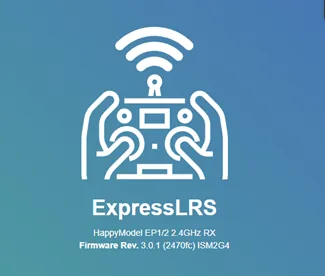
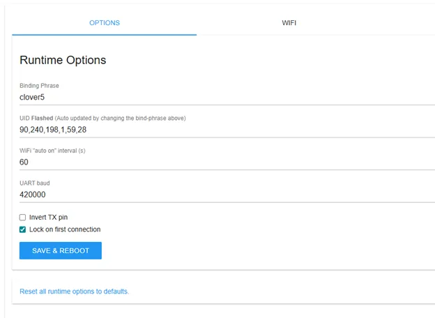

# Radio Controller Setup

## Contents
1. [Hardware overview](#hardware-overview)
2. [Radio controller setup](#radio-controller-setup)
3. [Binding the radio controller to the receiver](#binding-the-radio-controller-to-the-receiver)

## Hardware overview

Figure 1 - Radio controller, front view

Figure 2 - Radio controller, rear view

## Radio controller setup

1. Remove the black rubber grips from the back of the radio controller.
2. Insert the batteries, observing the correct polarity.
3. Put the rubber grips back in place.
4. Turn on the radio controller by holding the **POWER** button.

> **Caution** If warning messages appear on the radio controller screen, check the positions of the switches and the throttle stick. Before power-on, they must be in their default positions.

Figure 3 - Warning shown when switches or sticks are in the wrong position

After you return the switches and sticks to their default positions, the main menu will open.

Figure 4 - Radio controller main menu without a receiver link

## Binding the radio controller to the receiver

### Radio controller setup (transmitter)

1. Turn on the radio controller by holding the **POWER** button.
2. Press **SYS** and open the **ExpressLRS** menu, as shown in Figure 5.

    

Figure 5 - Opening the ExpressLRS menu for transmitter setup

3. Open the **WiFi Connectivity** tab and enable **Enable WiFi**, as shown in Figures 6 and 7.

  

    
  

  

    
  

  

    
    
Figure 6 - Opening WiFi Connectivity settings

    
Figure 7 - Enabling WiFi on the ExpressLRS transmitter

  

4. Connect from a PC or smartphone to the **ExpressLRS TX** network. The default password is **expresslrs**. An example is shown in Figure 8.

    

Figure 8 - Connecting to the ExpressLRS TX network

5. Open a browser and go to `10.0.0.1`. The start page is shown in Figure 9.

    > **Note** Pay attention to the firmware version. If it is lower than 3.3.1, update it with [ExpressLRS Web Flasher](https://expresslrs.github.io/web-flasher/).

    

Figure 9 - ExpressLRS transmitter web interface

6. Enter a unique **Binding Phrase** and press **SAVE**, as shown in Figure 10.

    

Figure 10 - Entering the Binding Phrase in the transmitter settings

7. In the pop-up window, press **REBOOT**, as shown in Figure 11.

    

Figure 11 - Rebooting the transmitter after saving settings

### Receiver setup

1. Put the receiver into **WiFi** mode by powering the flight controller connected to the ELRS receiver and waiting 60 seconds. After that, the receiver LED will blink continuously.

2. Connect from a PC or smartphone to the **ExpressLRS RX** network. The default password is **expresslrs**. An example is shown in Figure 12.

    

Figure 12 - Connecting to the ExpressLRS RX network

3. Open a browser and go to `10.0.0.1`. The start page is shown in Figure 13.

    > **Note** Pay attention to the firmware version. If it is lower than 3.0.0, update it with [ExpressLRS Web Flasher](https://expresslrs.github.io/web-flasher/).

    

Figure 13 - ExpressLRS receiver web interface

4. Enter the **same** unique **Binding Phrase** that was used on the transmitter, then press **SAVE & REBOOT**, as shown in Figure 14.

    

Figure 14 - Entering the Binding Phrase in the receiver settings

5. In the pop-up window, press **REBOOT**, as shown in Figure 15.

    

Figure 15 - Rebooting the receiver after saving settings

6. Setup is complete. After reboot, the link should appear as shown in Figure 16.

    

Figure 16 - Radio controller main menu after setup through Bind Phrase

### Alternative method: Bind mode

1. Put the receiver into **bind** mode by powering the flight controller connected to the ELRS receiver on and off three times.

> **Note** When the receiver enters bind mode, the LED on the receiver starts blinking twice with a pause.

2. On the radio controller, press **SYS** and open the **ExpressLRS** menu, as shown in Figure 17.

Figure 17 - Opening the ExpressLRS menu

3. Set **TX Power** to **100mW**, as shown in Figure 18.

Figure 18 - Setting transmitter power to 100mW

4. Press **Bind** and wait until binding finishes, as shown in Figure 19.

Figure 19 - Starting binding from the ExpressLRS menu

5. Press **RTN**. The receiver link indicator will appear in the main menu, as shown in Figure 20.

Figure 20 - Radio controller main menu after successful binding

