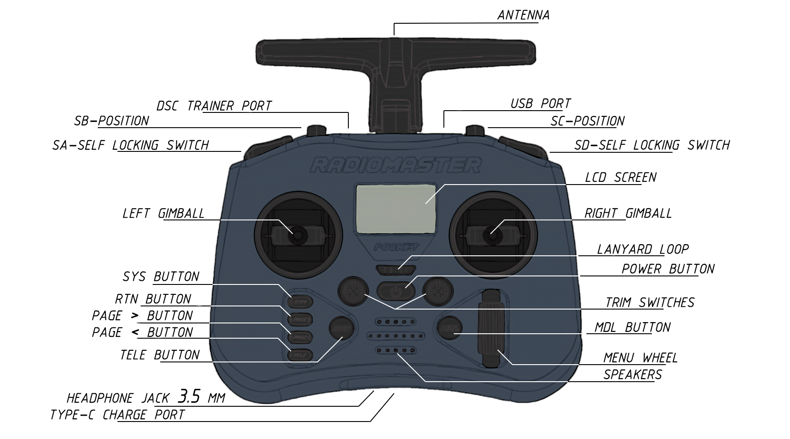
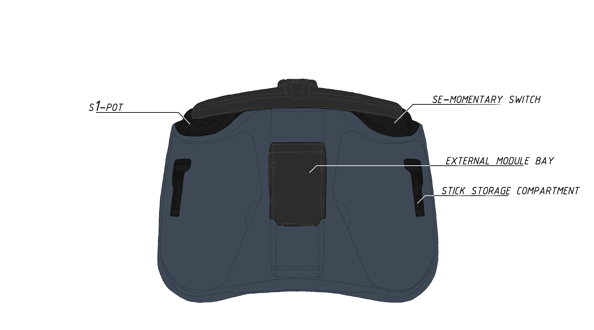

border# RC Transmitter Setup (Radio)

## Contents
1. [Transmitter Overview](#transmitter-overview)
2. [Transmitter Setup](#transmitter-setup)
3. [Creating a Drone Model](#creating-a-drone-model)
4. [Loading the Model](#loading-the-model)
5. [Binding Transmitter to Receiver](#binding-transmitter-to-receiver)
6. [Binding via Bind Phrase](#binding-via-bind-phrase)

## Transmitter Overview

## Transmitter Setup

1. Remove the black rubber grips from the back of the transmitter.
2. Insert the batteries, observing correct polarity.
3. Put the rubber grips back on.
4. Turn on the transmitter by holding the **POWER** button.

> **Important!** If you see a warning message on the screen (WARN image), check the position of the switches and the throttle stick—they must be in their zero (default) positions.

## Creating a Drone Model

1. Press the **MDL** button.
2. Select an empty slot and press the **scroll wheel (encoder)**.

3. Select **CREATE MODEL**.
4. Press the **PAGE >** button.
5. Use the **scroll wheel (encoder)** to select **«Model name»** and name your drone.

6. Return to the menu using the **RTN** button.
7. Scroll down with the **scroll wheel** and turn on the Internal RF (radio frequency module).

    
    

8. Go to the **MIXES** page and set up the aux switches on your transmitter:

    
    

9. You should have all switches configured from SA to S1. Once done, press **RTN**. The basic model setup is complete.

## Loading the Model

1. Download the drone model file to your PC [`model05.yml`](https://drive.google.com/file/d/19Ab9sWPvaOvIavkEXPXzDXCRajpBcO7e/view?usp=sharing).
2. Turn on the transmitter > plug the Type-C cable into the top USB port > select **USB Storage (SD)** from the popup menu.
3. In the opened file explorer, go to the **MODELS** folder and copy the `model05.yml` file into it.

    
    

## Binding Transmitter to Receiver

1. Put the receiver into **bind mode** by powering the flight controller (to which the ELRS RX is connected) on and off three times.

> **Important!** When the receiver enters bind mode, its LED will start doing a **double blink with a pause**.

2. Press the **SYS** button and navigate to the **ExpressLRS** LUA script.

3. Set **TX Power** to **100mW**.

4. Press **[Bind]** and wait for the pairing to complete.

    
    

5. Afterwards, hold the **RTN** button, and the connection telemetry icon will appear on the main screen.

## Binding via Bind Phrase

### Transmitter Setup (TX)

1. Turn on the transmitter by holding **POWER**.
2. Press **SYS** and navigate to the **ExpressLRS** menu.

3. Go to the **WiFi Connectivity** tab and turn on **Enable WiFi**.

4. From your PC or smartphone, connect to the newly appeared network **ExpressLRS TX**. Default password: **expresslrs**.

5. Open your browser and go to `10.0.0.1`.

> **Note on firmware version:** If it's lower than 3.3.1, you should update it via [ExpressLRS Web Flasher](https://expresslrs.github.io/web-flasher/).

6. Enter your unique **Binding Phrase** and click **SAVE**.

7. In the prompt window, click **REBOOT**.

### Receiver Setup (RX)

1. Put the receiver into **WiFi mode** by powering the flight controller and waiting for 60 seconds. The RX LED will start blinking rapidly and continuously.

2. Connect your PC or smartphone to the **ExpressLRS RX** network. Default password: **expresslrs**.

3. Open a browser and navigate to `10.0.0.1`.

> **Note on firmware version:** If it's lower than 3.0.0, you should update it via [ExpressLRS Web Flasher](https://expresslrs.github.io/web-flasher/).

4. Enter the **EXACT SAME** unique **Binding Phrase** you used on the transmitter, then click **SAVE & REBOOT**.

5. In the prompt window, click **REBOOT**.

6. Setup is complete.

