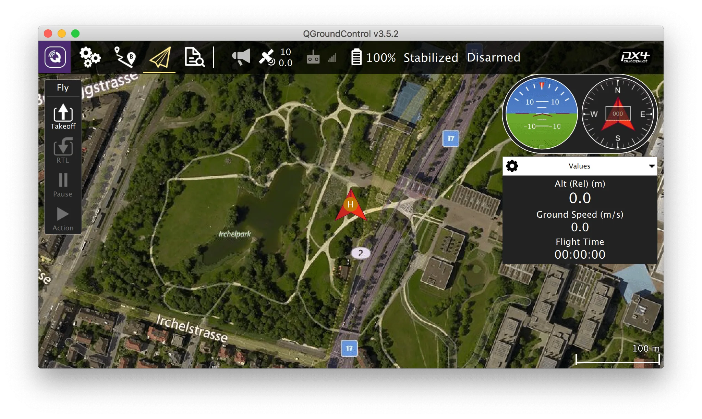
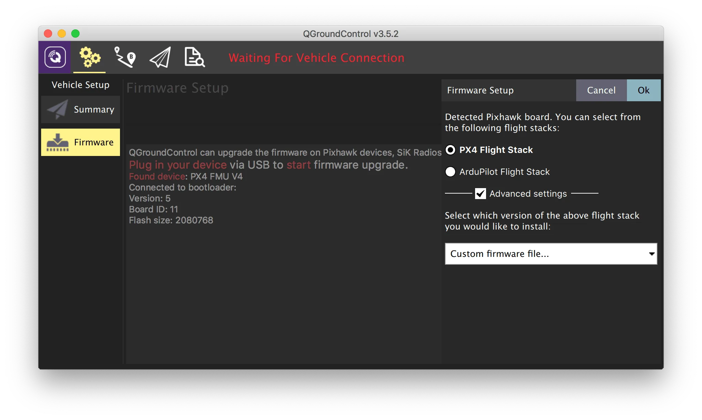
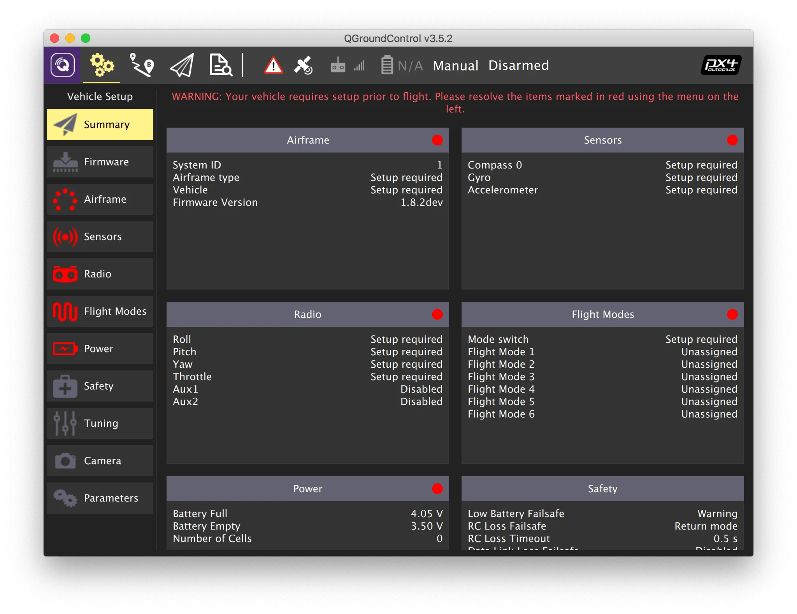
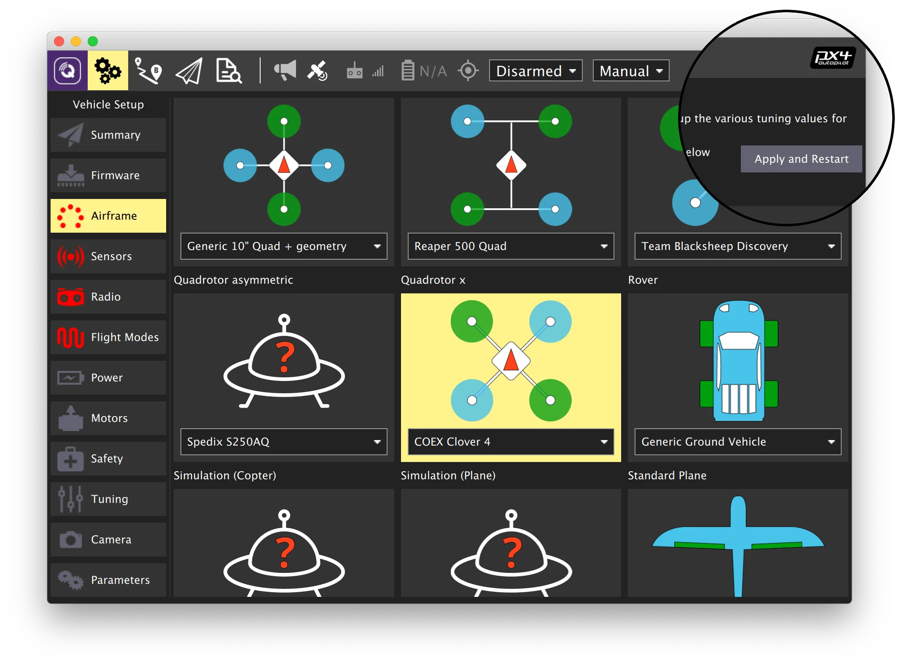
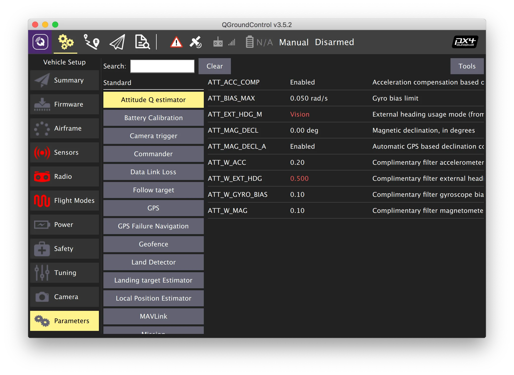

# Initial setup

## Installing QGroundControl

**QGroundControl** is a software package that can be used to flash, configure and calibrate the flight controller.

Download and install the installer for Windows/Linux/macOS [from the official QGroundControl website](https://docs.qgroundcontrol.com/Stable_V5.1/en/qgc-user-guide/getting_started/download_and_install.html). Agree to install additional drivers if prompted.

See also the [official QGroundControl documentation](https://docs.qgroundcontrol.com/Stable_V5.1/en/qgc-user-guide/).

## Flashing the flight controller

Download the PX4 firmware for your flight controller. Current versions:

- For `micoair_h743-v2` — **1.16.0**, file [`micoair_h743-v2_default.px4`](https://github.com/PX4/PX4-Autopilot/releases/download/v1.16.0/micoair_h743-v2_default.px4).
- For `pixracer_R15` — **1.13.3**, file [`px4fmu-v4_default.px4`](https://github.com/PX4/PX4-Autopilot/releases/download/v1.13.3/px4fmu-v4_default.px4).

Flashing instructions:

1. Disconnect the flight controller from the computer (if connected).
2. Launch QGroundControl.
3. Go to the *Vehicle Configuration* panel (click the QGroundControl logo in the top-left corner) and select the *Firmware* menu.
4. Connect the flight controller to the computer via USB.
5. Select *PX4 Flight Stack* in the menu that appears on the right.

6. To select and load the firmware file:
   - Select *Advanced settings*.
   - Choose *Custom firmware file...* from the dropdown menu.
   - Press *OK* and select the downloaded firmware file.

Wait for QGroundControl to flash the firmware and reboot the flight controller.

> **Warning** Do not disconnect the flight controller from the computer during the flashing process.

## Configuring the flight controller

> **Hint** All further configuration and calibration of the flight controller can be done wirelessly using [Wi-Fi access to the flight controller via Raspberry Pi](gcs_bridge.md).

1. Parameters requiring setup: *Airframe*, *Radio*, *Sensors*, *Flight Modes*.
2. Current controller firmware.
3. Current flight mode.
4. Error messages.

### Selecting the airframe

1. Select the *Airframe* menu.
2. Select the *Quadrotor* frame type.
3. For Clover 4, select the *COEX Clover 4* frame subtype. For Clover 5 — *Generic Quadrotor*.
4. Scroll to the top of the list and press *Apply and Restart*, confirm by pressing *Apply*.
5. Wait for the settings to apply and the flight controller to reboot.

### Parameters

To configure flight controller parameters, go to the *Vehicle Configuration* tab and select the *Parameters* menu. Use the *Search* field to find parameters by name. Recommended parameters for Clover are provided in the further documentation.

After setting a parameter, press *Save*. If needed, reboot the flight controller by pressing *Tools* > *Reboot vehicle*.

#### Parameter files

You can load a pre-configured preset via the *Parameters* tab menu: press *Tools*, then select *Load from file...* in the popup window and choose the `.params` file.

- Parameters for Clover 4: [clover-4.params](https://drive.google.com/file/d/1lPq6y8CVDUKBxo5hVujcWUJAfzTqqCx1/view?usp=sharing)
- Parameters for Clover 5: [clover-5.params](https://drive.google.com/file/d/1z8tDCJZqSyJtySgBizllgdF7DIC28A9C/view?usp=sharing)

#### Configuring PID regulators

##### Averaged PID coefficients for Clover 5

* `MC_PITCHRATE_P` = 0.176
* `MC_PITCHRATE_I` = 0.213
* `MC_PITCHRATE_D` = 0.0018
* `MC_ROLLRATE_P` = 0.176
* `MC_ROLLRATE_I` = 0.213
* `MC_ROLLRATE_D` = 0.0018
* `MC_YAWRATE_P` = 0.25
* `MC_YAWRATE_I` = 0.09
* `MPC_XY_P` = 1.8
* `MPC_Z_P` = 1.5
* `MPC_XY_VEL_P_ACC` = 3.45
* `MPC_XY_VEL_D_ACC` = 0.15
* `MPC_XY_VEL_I_ACC` = 1.0
* `MPC_Z_VEL_P_ACC` = 5.5
* `MPC_Z_VEL_I_ACC` = 2.3
* `MPC_THR_HOVER` = 0.4
* `MPC_ACC_DOWN_MAX` = 2.0

##### Averaged PID coefficients for Clover 4

* `MC_PITCHRATE_P` = 0.072
* `MC_PITCHRATE_I` = 0.037
* `MC_PITCHRATE_D` = 0.0021
* `MC_PITCH_P` = 8.5
* `MC_ROLLRATE_P` = 0.072
* `MC_ROLLRATE_I` = 0.037
* `MC_ROLLRATE_D` = 0.0021
* `MC_ROLL_P` = 8.5
* `MPC_XY_VEL_P_ACC` = 2.2
* `MPC_XY_VEL_D_ACC` = 0.26
* `MPC_XY_P` = 0.9
* `MPC_Z_VEL_P_ACC` = 4.8
* `MPC_Z_P` = 1.2

> **Hint** Note that PID regulator parameters should be tuned manually for each specific assembled quadcopter for ideal flight. Learn more in the "[PID tuning](calibratePID.md)" article.

**Next**: [Sensor calibration](calibration.md).
