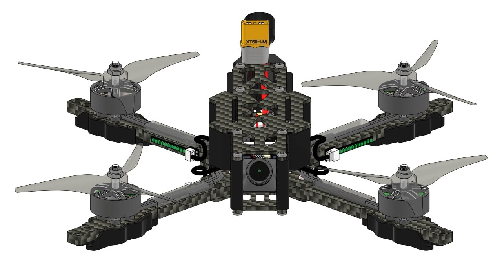
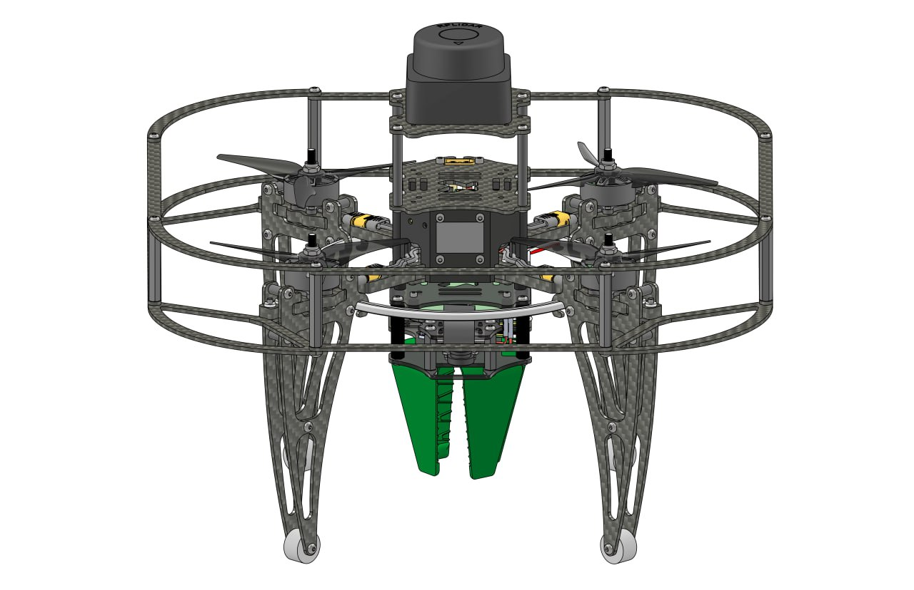
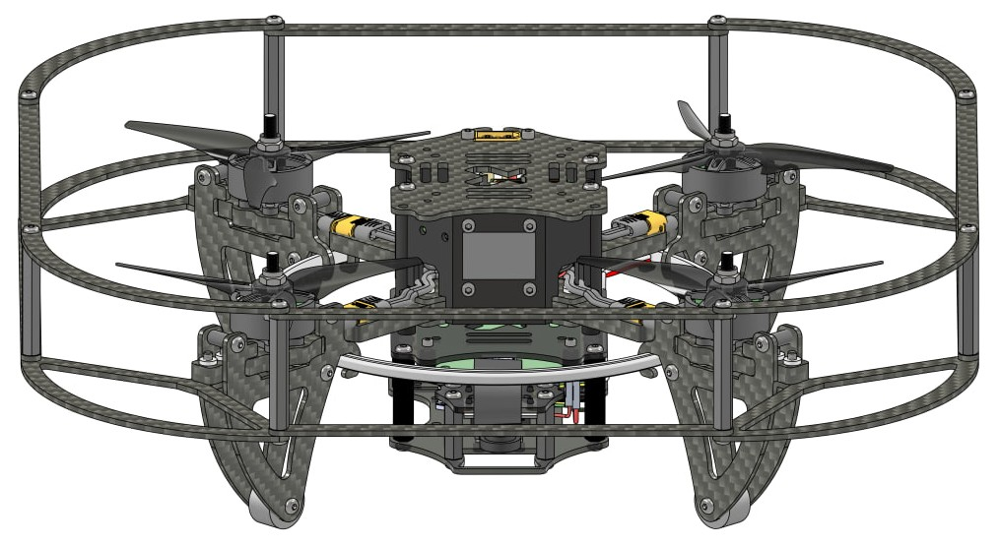

# Сборка Клевера

В этом разделе находится статьи, описывающие сборку каждой из версии Клевера.

<table class=versions>
     <tr><th>Версия</th><th>Изображение</th></tr>
     <tr>
          <td><a href="assemble_5_fpv.md">Клевер&nbsp;5&nbsp;FPV</a></td>
          <td></td>
     </tr>
     <tr>
          <td><a href="assemble_5_dev.md">Клевер&nbsp;5&nbsp;DEV</a></td>
          <td></td>
     </tr>
     <tr>
          <td><a href="assemble_5.md">Клевер&nbsp;5</a></td>
          <td></td>
     </tr>
     <tr>
          <td>
               <a href="assemble_4_2.md">Клевер&nbsp;4.2</a>
               

                    (<a href="assemble_4_2_ws.md">WorldSkills</a>,
                    <a href="assemble_4_2_pro.md">Pro</a>)
               

          </td>
          <td></td>
     </tr>
     <tr>
          <td><a href="assemble_4_1.md">Клевер&nbsp;4.1</a></td>
          <td></td>
     </tr>
     <tr>
          <td><a href="assemble_4.md">Клевер&nbsp;4</a></td>
          <td></td>
     </tr>
</table>

Ссылки на CAD-модели деталей Клевера доступны в статье "[CAD-модели](models.md)".
