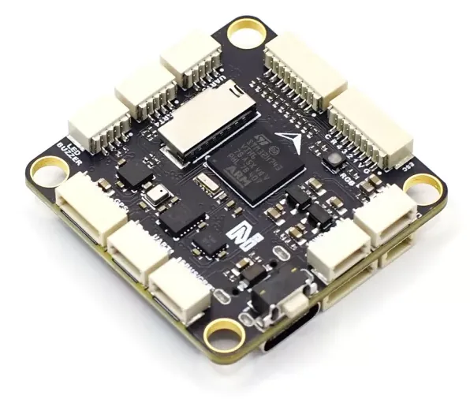
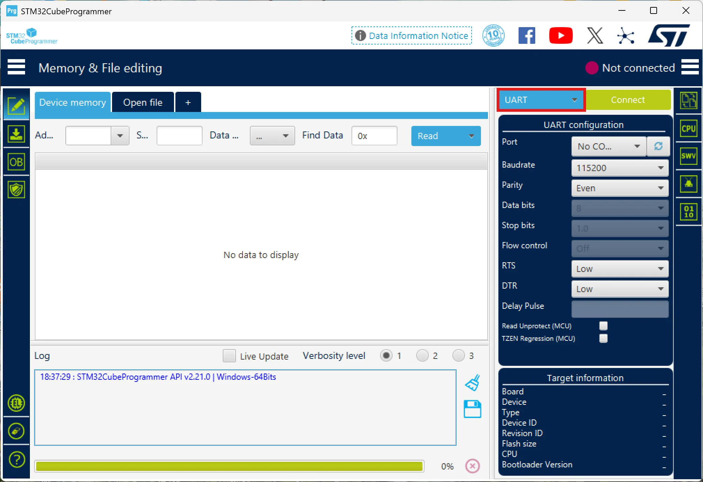
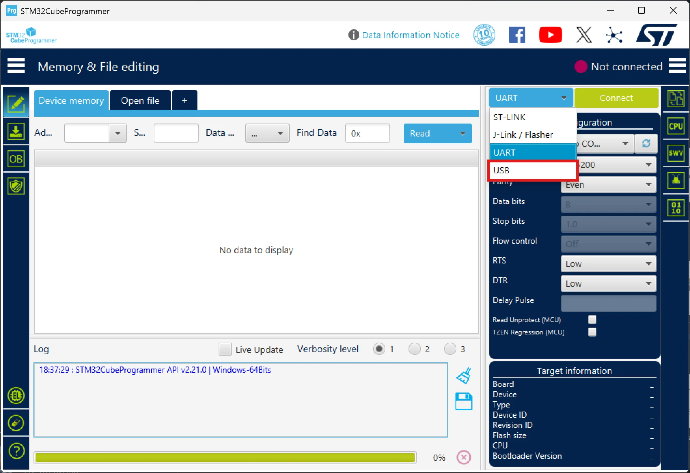
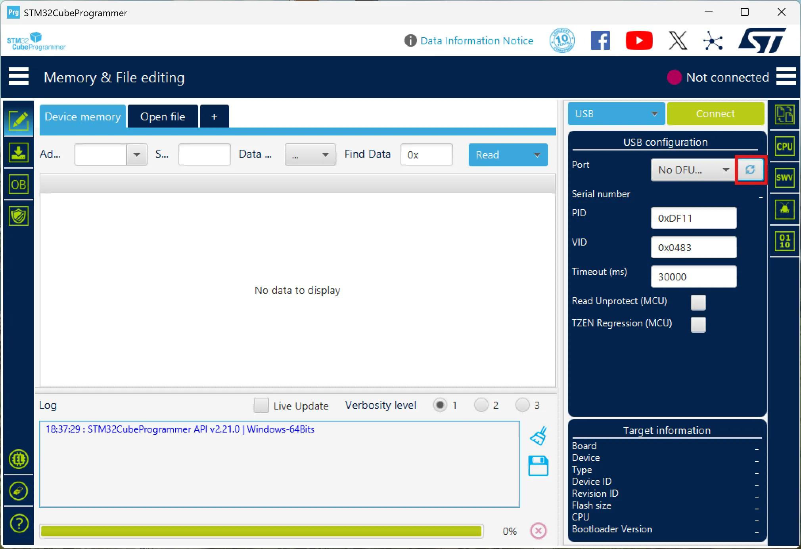
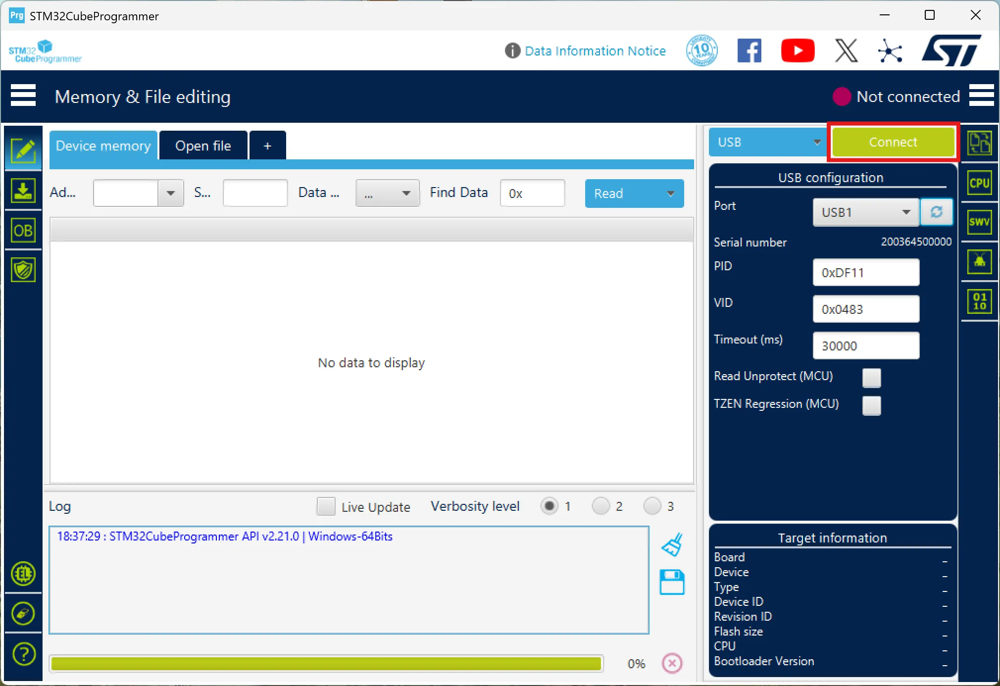
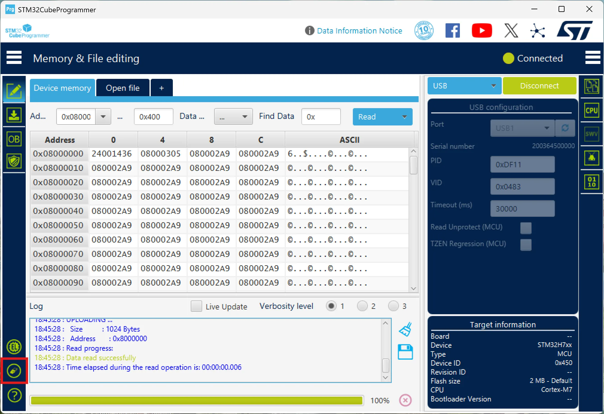
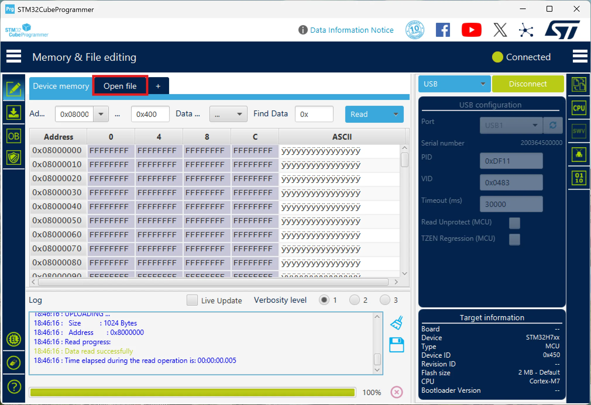
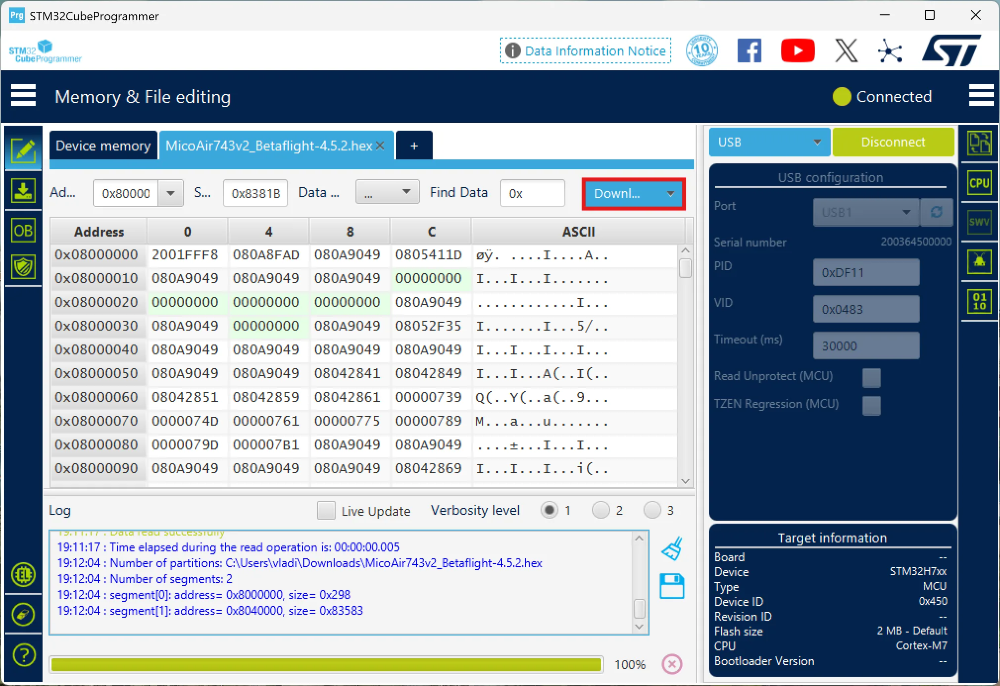
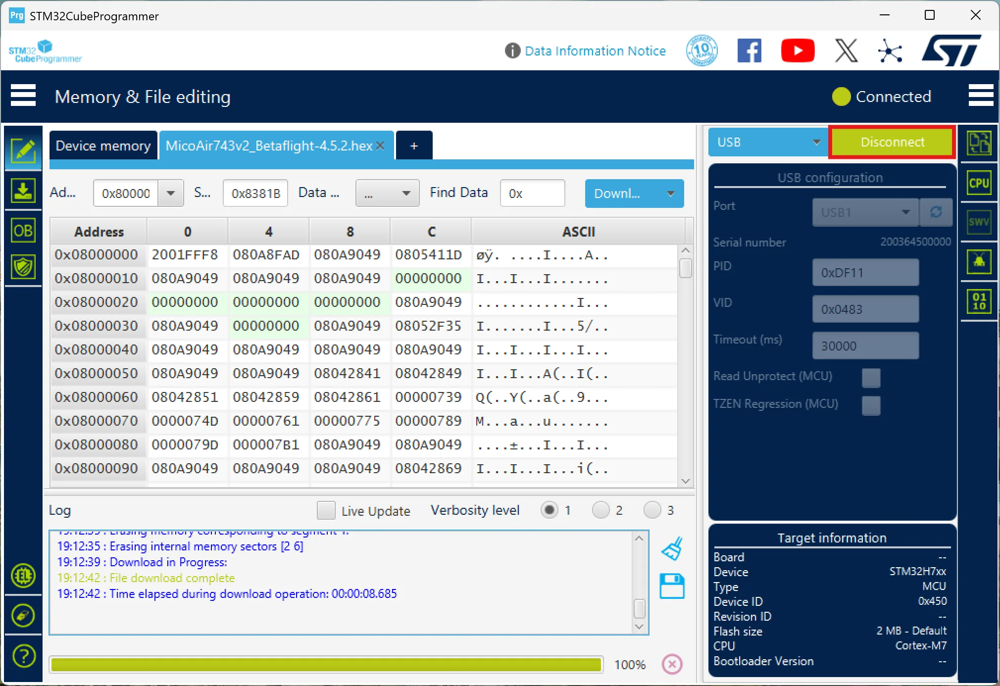
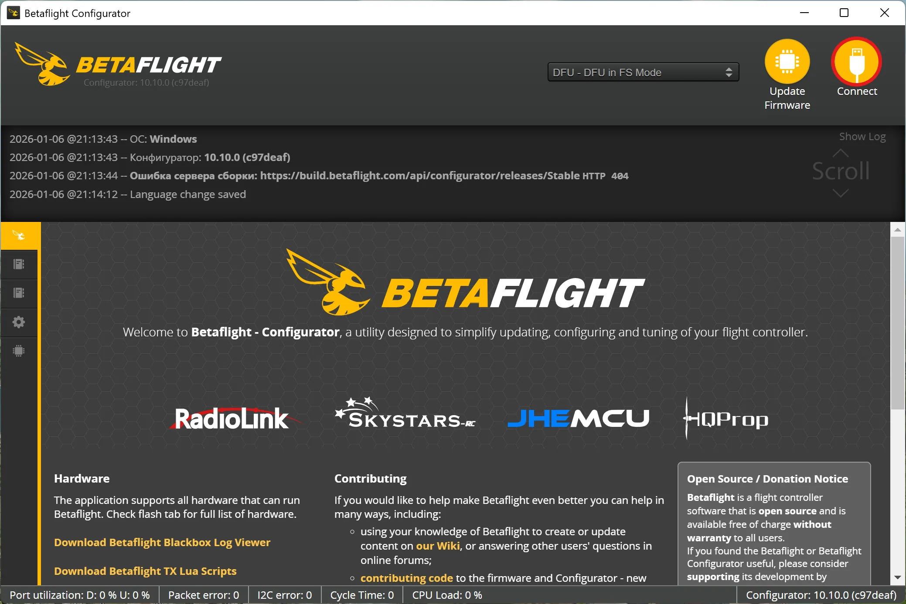

# Прошивка MicoAir743v2 с PX4 на Betaflight

> **Success** Документация описывает безопасную процедуру перепрошивки полётного контроллера **MicoAir743v2** между PX4 и Betaflight через DFU/bootloader.
> [Документация по прошивке с Betaflight на PX4](firmware_PX4_MicoAir743v2.md)

> **Caution** Данная инструкция подходит **только для полётного контроллера MicoAir743v2**.  
> Если у вас **Pixracer / COEX Pix / Pixhawk**, используйте документацию по прошивке PX4 для Pixracer:
> [PX4 firmware in Pixracer](firmware_Pixracer.md)

  
   
  MicoAir743v2 flight controller

## Содержание
1. [Ссылки на ПО и прошивку](#ссылки-на-по-и-прошивку)
2. [Вход в DFU / bootloader mode](#вход-в-dfu--bootloader-mode)
3. [Прошивка с PX4 на Betaflight](#прошивка-с-px4-на-betaflight)

## Ссылки на ПО и прошивку

- **Betaflight Configurator** - официальный релиз‑раздел: [github.com/betaflight/betaflight-configurator/releases](https://github.com/betaflight/betaflight-configurator/releases)
- **STM32CubeProgrammer** (Google Drive): [drive.google.com (STM32CubeProgrammer)](https://drive.google.com/file/d/1Iku7s-Pmpvm8ctj7OK7KDgX6tYp3GB6a/view?usp=drive_link)
- **Прошивка Betaflight** для MicoAir743v2: [drive.google.com (Betaflight firmware)](https://drive.google.com/file/d/1gaLgiCqa-gUa-vJtmGSQhVh7zwCFcqFN/view?usp=drive_link)

## Вход в DFU / bootloader mode

1. Зажмите кнопку **BOOT** на контроллере.
2. Не отпуская BOOT, подключите USB к ПК.
3. В системе устройство должно определиться как DFU/STM32 Bootloader.

## Прошивка с PX4 на Betaflight

> **Caution** **Установка программатора (STM32CubeProgrammer)**  
> Перед прошивкой скачайте и установите STM32CubeProgrammer.

1. Переведите полётный контроллер в режим **DFU** (зажмите кнопку BOOT и подключите по проводу USB к компьютеру). Откройте STM32CubeProgrammer, нажмите на кнопку выбора протокола подключения (UART).
    

2. Выберите протокол USB.
    

3. Обновите порт, для этого нажмите на кнопку справа от выбора порта.
После чего автоматически выберется нужный порт (Если не выбрался, значит полётный контроллер не в режиме DFU, повторите первый пункт).
    

4. Нажмите кнопку "Connect".
    

5. Выполните полную очистку, для этого нажмите кнопку с ластиком в левом нижнем углу, во всплывающем окне подтвердите действия. Дождитесь окончания очистки.
    

6. Нажмите на кнопку **Open file** и выберите файл "MicoAir743v2_Betaflight-4.5.2.hex".
    

7. Для загрузки прошивки нажмите кнопку "Download" и дождитесь окончания загрузки.
    

8. Нажмите кнопку "Disconnect".
    

9. Откройте Betaflight Configurator и приступайте к настройке.
    

