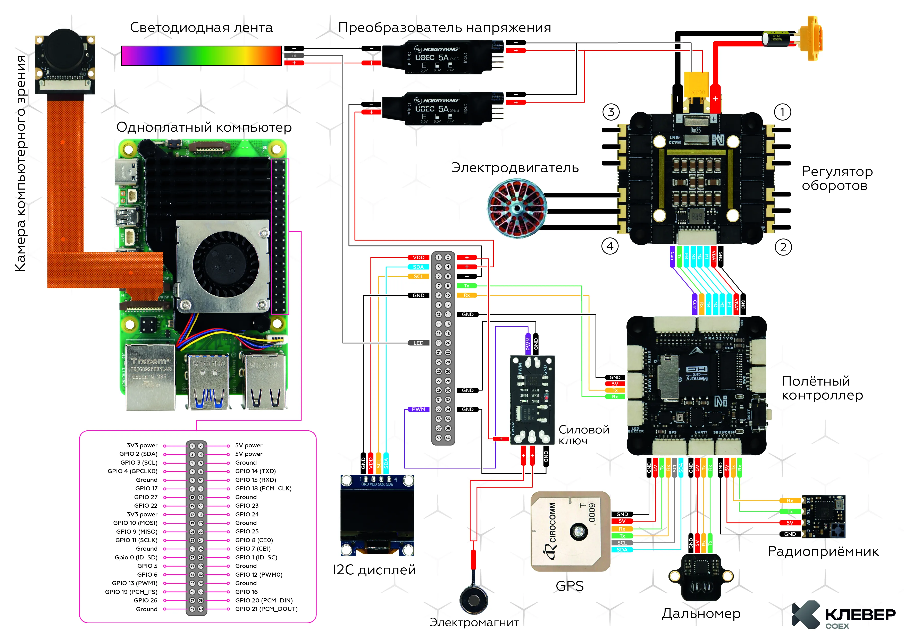
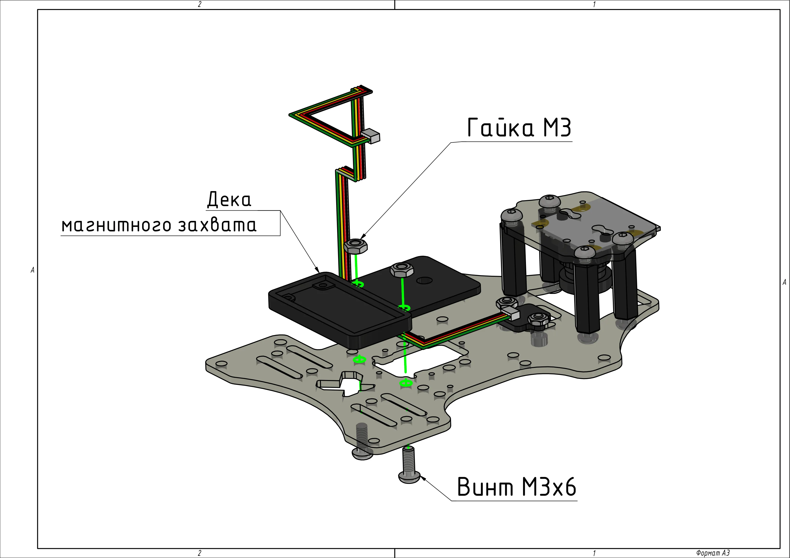
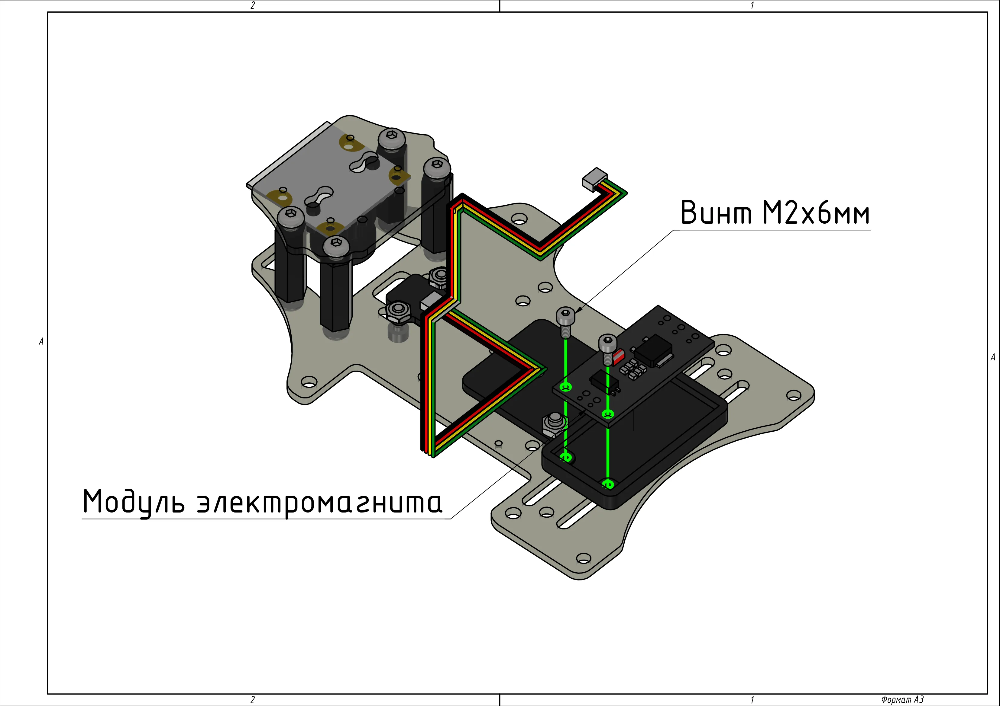
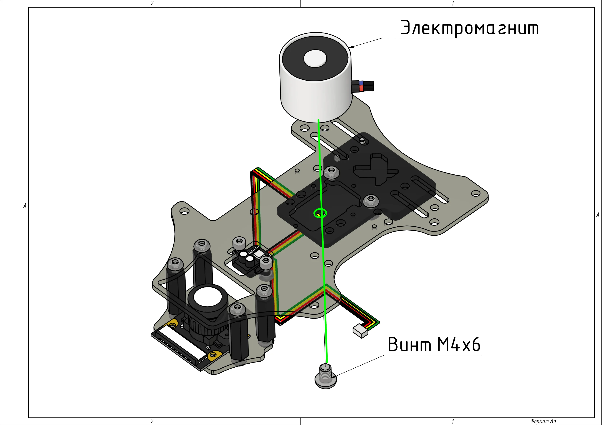
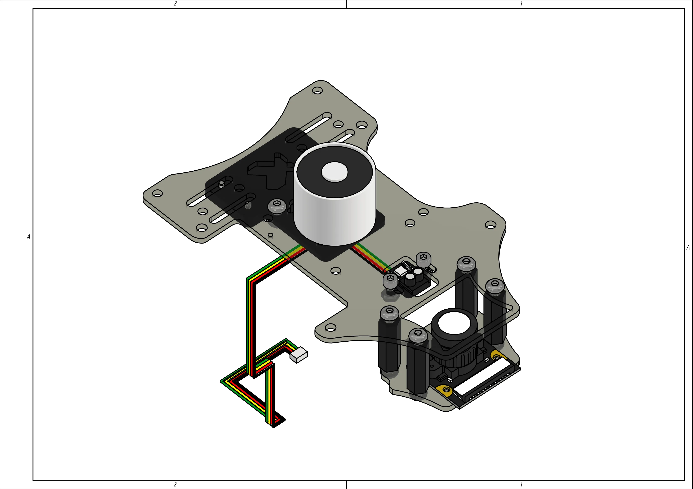
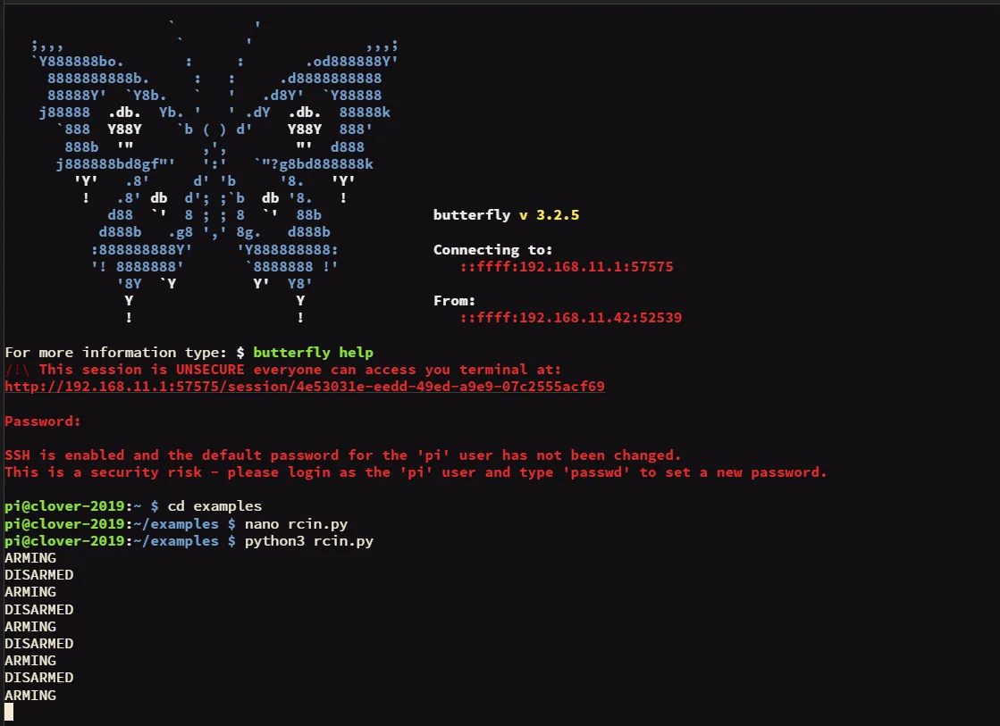
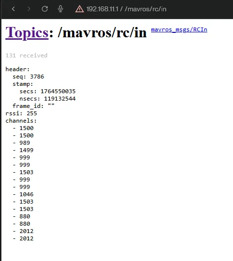

# Работа с магнитным захватом

## Содержание
1. [Сборка и установка модуля](#сборка-и-установка-модуля)
2. [Проверка работоспособности](#проверка-работоспособности)
3. [Управление магнитным захватом с помощью аппаратуры](#управление-магнитным-захватом-с-помощью-аппаратуры)
   - [Чтение значений каналов RC](#чтение-значений-каналов-rc)
   - [Пример кода управления магнитным захватом](#пример-кода-управления-магнитным-захватом)

## Сборка и установка модуля

1. Спаяйте модуль магнитного захвата согласно схеме подключения. Провода на концах должны быть с разъемами Dupont female (длина проводов ~10-15см).

    <div align="center"></div>

    <div align="center"><em>Схема подключения электроники</em></div>

2. Установите деку магнитного захвата при помощи винтов M3x6 и гаек М3.

    <div align="center"></div>

3. Установите модуль электромагнита на деку захвата с помощью винтов M2x6.

    <div align="center"></div>

4. Установите электромагнит на деку захвата при помощи винта M4x6.

    <div align="center"></div>

5. Магнитный захват в сборе.

    <div align="center"></div>

6. Подключите магнитный захват к Raspberry Pi согласно схеме подключения электроники (см. пункт 1).

## Проверка работоспособности

Загрузите пример кода для работы с магнитным захватом чтобы проверить работоспособность.

```python
from rpi_hardware_pwm import HardwarePWM
import time


# pwmchip0, канал 1
pwm = HardwarePWM(pwm_channel=1, hz=50, chip=0)


def control_magnet(on_time=2, off_time=2):
    try:
        pwm.start(0)
        while True:
            print("ВКЛ")
            pwm.change_duty_cycle(100)
            time.sleep(on_time)
            print("ВЫКЛ")
            pwm.change_duty_cycle(0)
            time.sleep(off_time)
    finally:
        pwm.stop()


if __name__ == "__main__":
    control_magnet(on_time=2, off_time=2)
```

## Управление магнитным захватом с помощью аппаратуры

### Чтение значений каналов RC

> Информацию по топикам MAVROS см. по [ссылке](https://clover.coex.tech/ru/mavros.html).

Пример кода для считывания значений с каналов при переключении тумблера:

```python
import rospy
from mavros_msgs.msg import RCIn


last_state = None


def rc_callback(data: RCIn):
    global last_state

    if len(data.channels) <= 6:
        return

    ch = data.channels[6]

    if ch < 1000:
        state = 'ARMING'
    elif ch > 1900:
        state = 'DISARMED'
    else:
        state = None

    if state is not None and state != last_state:
        print(state)
        last_state = state


def main():
    rospy.init_node('rc_reader')
    rospy.Subscriber('mavros/rc/in', RCIn, rc_callback)
    rospy.spin()


if __name__ == '__main__':
    main()
```

Пример вывода в топике и терминале:
<div align="center">
    
    
</div>

### Пример кода управления магнитным захватом

Пример кода управления магнитным захватом через аппаратуру:

```python
import rospy
from mavros_msgs.msg import RCIn
from rpi_hardware_pwm import HardwarePWM


pwm = None
magnet_on = False


def rc_callback(data: RCIn):
    global magnet_on

    if 6 >= len(data.channels):
        return

    ch = data.channels[6]

    if ch < 1000 and magnet_on:
        rospy.loginfo("OFF")
        pwm.change_duty_cycle(0)
        magnet_on = False
    elif ch > 1900 and not magnet_on:
        rospy.loginfo("ON")
        pwm.change_duty_cycle(100)
        magnet_on = True


def main():
    global pwm

    rospy.init_node('magnet_rc')
    pwm = HardwarePWM(pwm_channel=1, hz=50, chip=0)
    pwm.start(0)
    rospy.Subscriber('mavros/rc/in', RCIn, rc_callback)
    rospy.loginfo("magnet_rc start")
    rospy.spin()
    pwm.stop()


if __name__ == '__main__':
    main()
```

Пример кода для плавного захвата груза с помощью сервопривода:

```python
import rospy
from mavros_msgs.msg import RCIn
from rpi_hardware_pwm import HardwarePWM

pwm = None

S1_INDEX = 8 

RC_MIN = 1000
RC_MAX = 2000

ANGLE_MIN = 0.0
ANGLE_MAX = 90.0

DUTY_MIN = 3
DUTY_MAX = 12

def rc_callback(msg: RCIn):
    if len(msg.channels) <= S1_INDEX:
        return

    ch = msg.channels[S1_INDEX]

    if ch < RC_MIN:
        ch = RC_MIN
    elif ch > RC_MAX:
        ch = RC_MAX

    k = float(ch - RC_MIN) / float(RC_MAX - RC_MIN)

    angle = ANGLE_MIN + (ANGLE_MAX - ANGLE_MIN) * k

    duty = DUTY_MIN + (DUTY_MAX - DUTY_MIN) * (angle / ANGLE_MAX)

    pwm.change_duty_cycle(duty)

def main():
    global pwm

    rospy.init_node('servo_from_slider')

    pwm = HardwarePWM(pwm_channel=1, hz=50, chip=0)
    pwm.start(DUTY_MIN)

    rospy.Subscriber('mavros/rc/in', RCIn, rc_callback)
    rospy.loginfo('servo_from_slider start')
    rospy.spin()

    pwm.stop()

if __name__ == '__main__':
    main()
```
