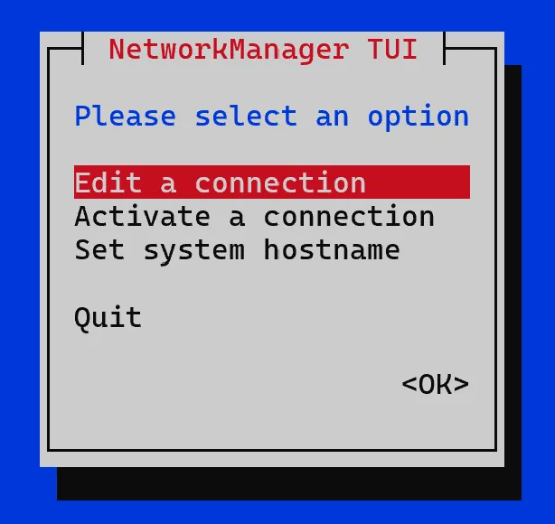
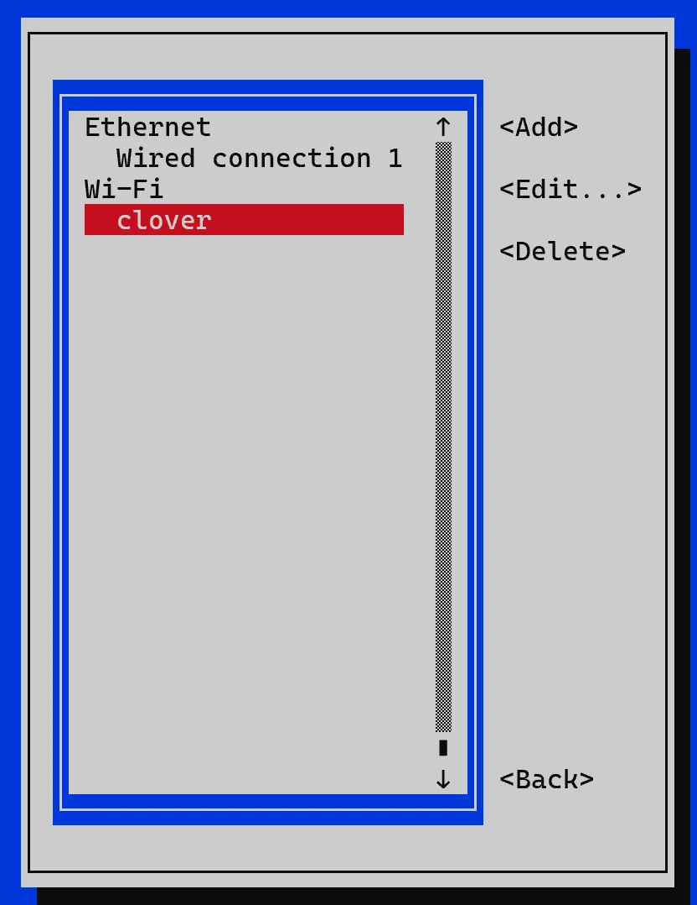
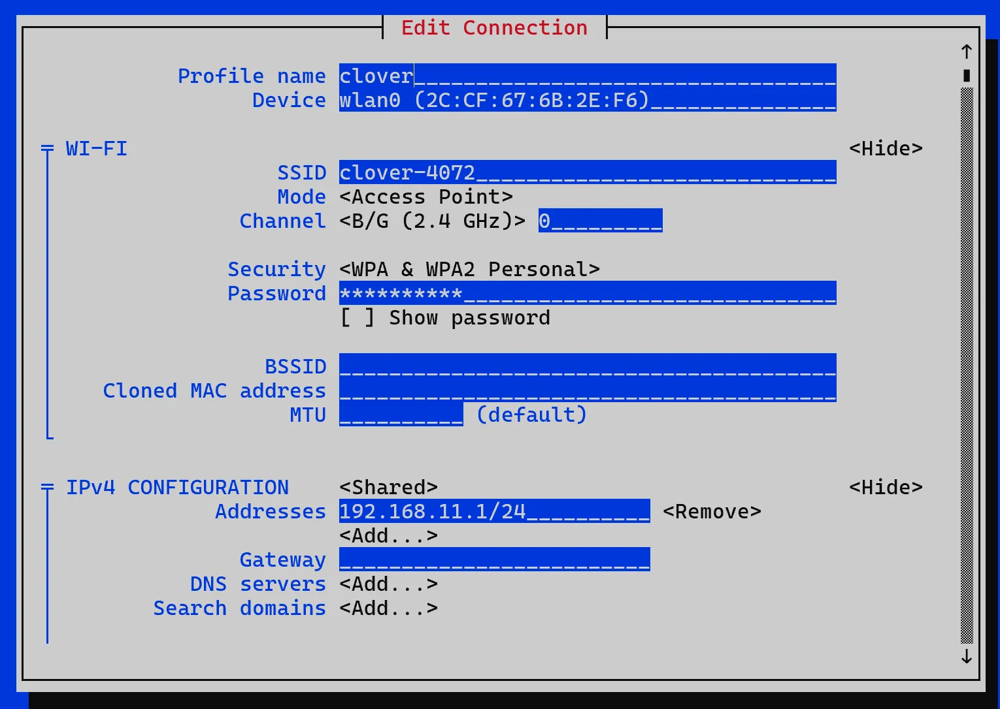
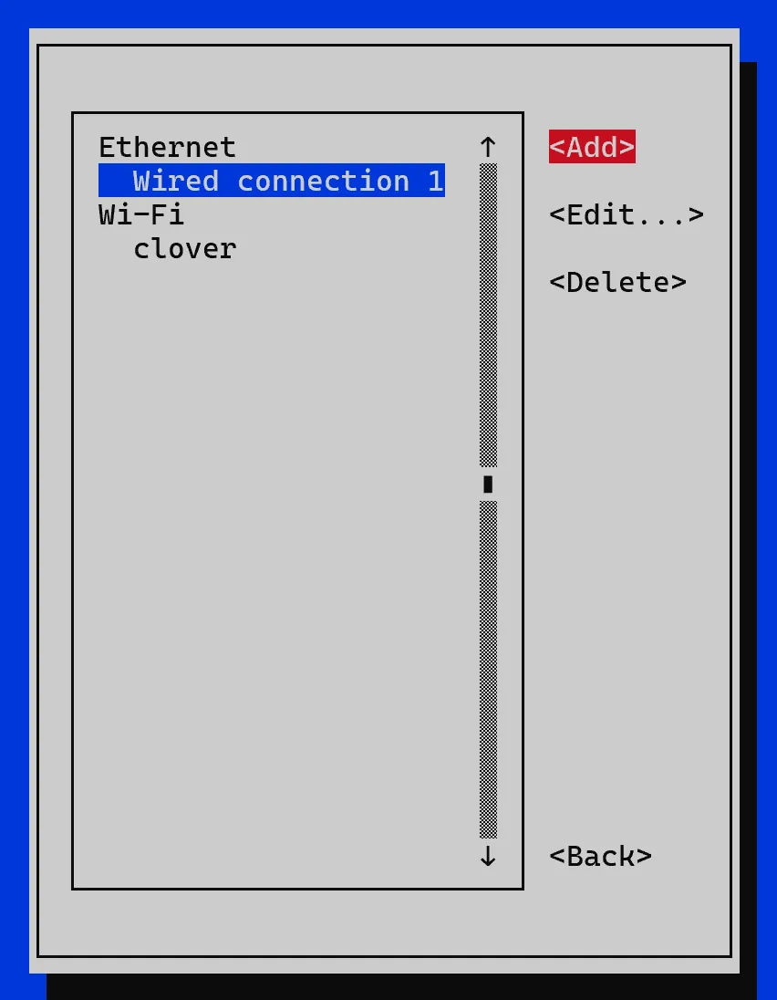
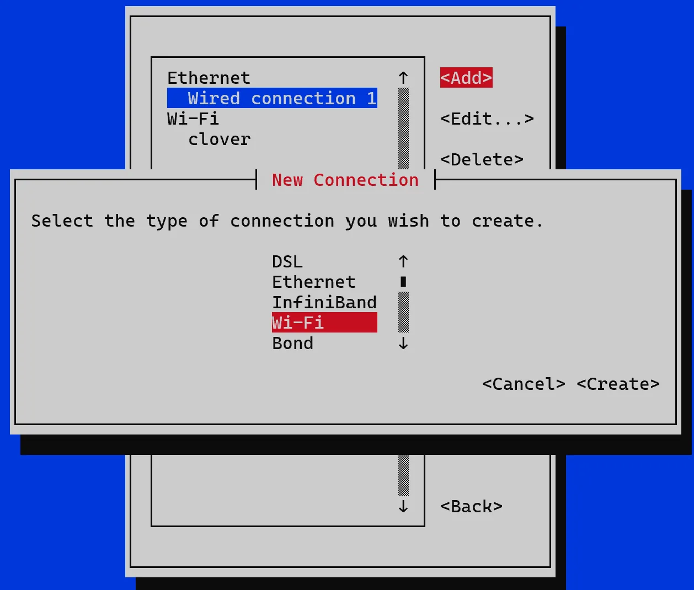
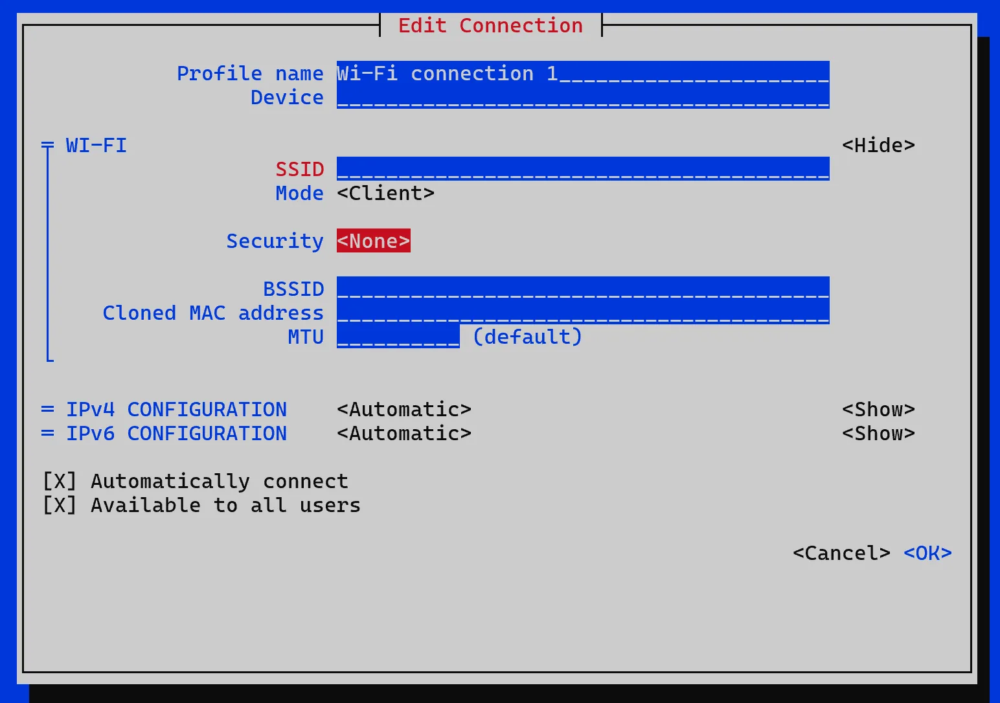
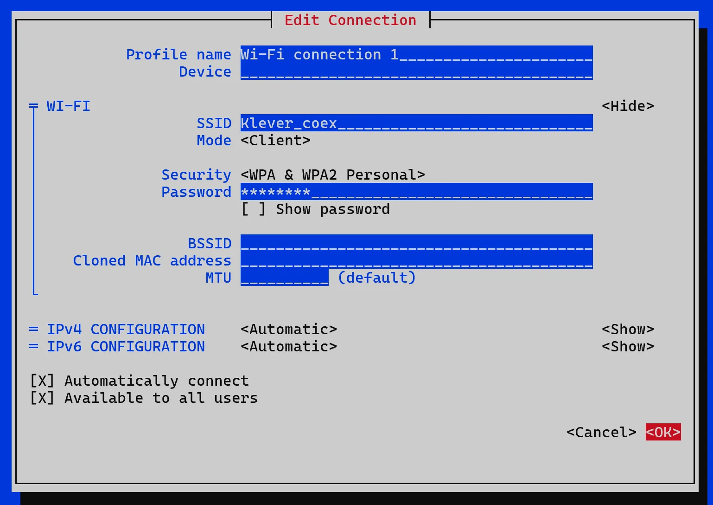
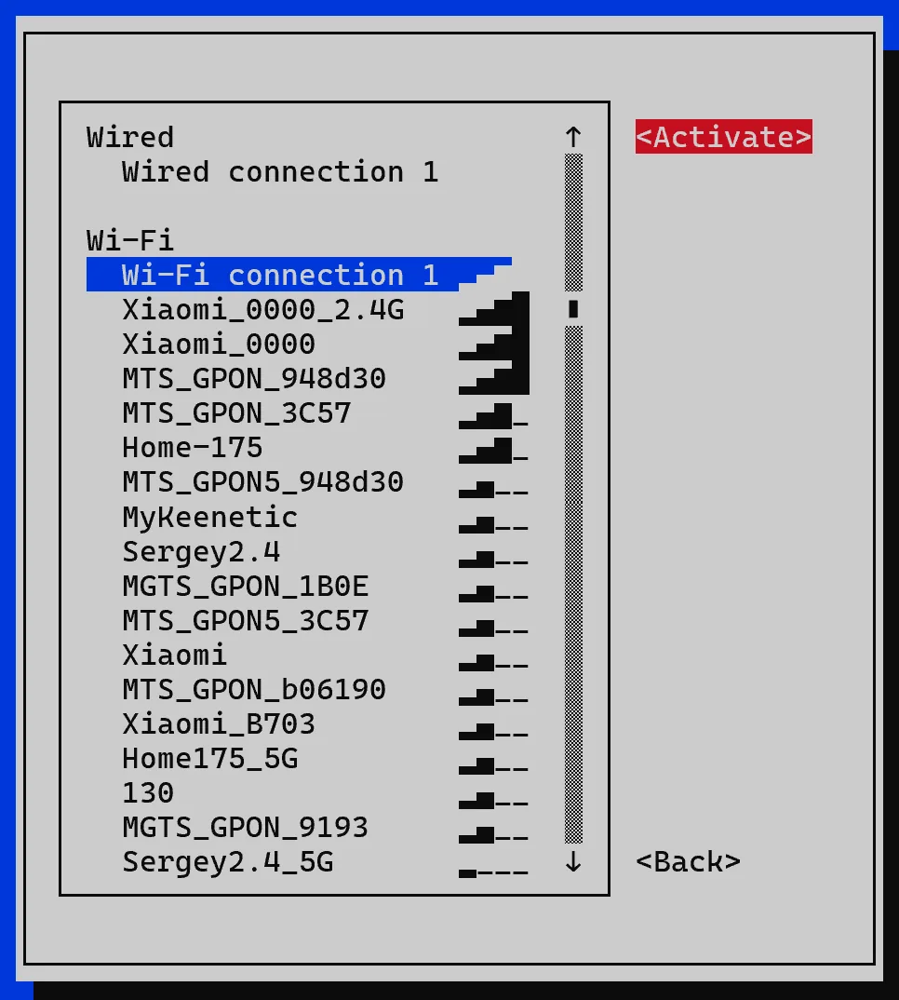
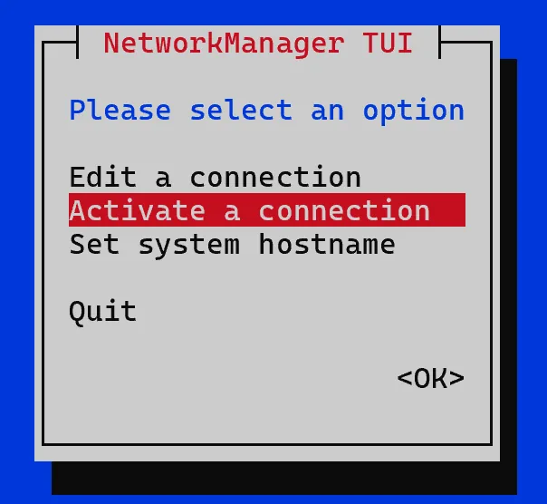
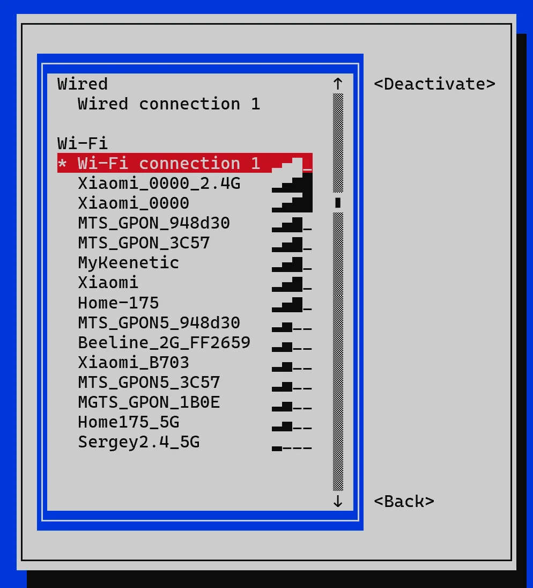

# Настройка Wi-Fi RPi через NetworkManager

## Содержание
1. [Изменение пароля или SSID (имени сети)](#изменение-пароля-или-ssid-имени-сети)
2. [Переключение адаптера в режим клиента](#переключение-адаптера-в-режим-клиента)
3. [Переключение адаптера в режим точки доступа](#переключение-адаптера-в-режим-точки-доступа)
4. [Устройство сети RPi с NetworkManager](#устройство-сети-rpi-с-networkmanager)

Сеть на Raspberry Pi можно настроить через `NetworkManager` и его текстовый интерфейс `nmtui`.

`NetworkManager` – это системный сервис, который управляет сетевыми интерфейсами и хранит профили подключений. В нашем случае сервис отвечает за настройки Wi-Fi на Raspberry Pi, а `nmtui` дает удобный текстовый интерфейс, чтобы менять эти параметры без ручного редактирования нескольких конфигурационных файлов.

Через `NetworkManager` можно переключать Wi-Fi адаптер Raspberry Pi между двумя основными режимами работы:

1. **Режим клиента (Mode = Client)** – Raspberry Pi подключается к существующей Wi-Fi сети.
2. **Режим точки доступа (Mode = Access Point)** – Raspberry Pi создает Wi-Fi сеть, к которой вы можете подключиться.

Подключитесь к Raspberry Pi локально или по [SSH](ssh.md) и запустите интерфейс настройки:

```bash
sudo nmtui
```

## Изменение пароля или SSID (имени сети)

1. Запустите `sudo nmtui`.

2. Выберите `Edit a connection`.

  <div align="center">
    
    <p>Рисунок 1 – Главное меню nmtui</p>
  </div>

3. Выберите профиль точки доступа `clover` и нажмите `Edit` (см. рисунок 2). Если такого профиля нет, создайте его через `Add` -> `Wi-Fi`.

  <div align="center">
    
    <p>Рисунок 2 – Выбор профиля подключения</p>
  </div>

4. В окне редактирования профиля измените поля `SSID` и `Password`, как показано на рисунке 3:
    * поле `SSID` — чтобы поменять имя Wi-Fi сети;
    * поле `Password` — чтобы поменять пароль;

  <div align="center">
    
    <p>Рисунок 3 – Изменение SSID и пароля в профиле точки доступа</p>
  </div>

  > **Caution** Длина пароля для Wi-Fi сети должна быть **не менее** 8 символов.
  > Если вы изменили поле `SSID`, после повторной активации нужно будет подключиться к сети уже под новым именем.

5. Нажмите `OK`, затем `Back`.

6. Чтобы применить изменения введите команду и дождитесь перезагрузки:

    ```bash
    sudo systemctl restart NetworkManager
    ```

## Переключение адаптера в режим клиента

> **Note** **Режим клиента** – Raspberry Pi подключается к существующей Wi-Fi сети.

1. Запустите `sudo nmtui`.

2. Выберите `Edit a connection`.

  <div align="center">
    
    <p>Рисунок 4 – Главное меню nmtui</p>
  </div>

3. Создайте новый профиль, для этого выберите `Add` (см. рисунок 5).

  <div align="center">
    
    <p>Рисунок 5 – Добавление нового профиля подключения</p>
  </div>

4. В окне `New Connection` выберите `Wi-Fi` (см. рисунок 6).

  <div align="center">
    
    <p>Рисунок 6 – Выбор типа нового подключения Wi-Fi</p>
  </div>

5. В окне `Edit Connection` выберите `Security` и поменяйте протокол защиты на `WPA & WPA2 Personal` (или другой протокол защиты, в зависимости от вашего роутера и его настроек), как показано на рисунке 7.

  <div align="center">
    
    <p>Рисунок 7 – Настройка параметров безопасности для профиля клиента</p>
  </div>

6. Введите `SSID` и `Password`, после чего нажмите `OK` (см. рисунок 8).

  <div align="center">
    
    <p>Рисунок 8 – Ввод имени сети и пароля для подключения в режиме клиента</p>
  </div>

7. Выйдите из `nmtui`, для этого нажмите `Back`, затем `Quit`. Введите команду и дождитесь перезагрузки:

    ```bash
    sudo reboot
    ```

8. Запустите `sudo nmtui`.

9. Перейдите в `Activate a connection` и выберите созданный профиль (если не меняли название сети, то `Wi-Fi connection 1`), нажмите `Activate`.

  <div align="center">
    
    <p>Рисунок 9 – Активация созданного профиля клиента</p>
  </div>

> **Success** Дождитесь перезагрузки, после чего Raspberry Pi подключится к сети.

## Переключение адаптера в режим точки доступа

> **Note** **Режим точки доступа** – Raspberry Pi создает Wi-Fi сеть, к которой вы можете подключиться.

1. Запустите `sudo nmtui`.

2. Выберите `Activate a connection`.

  <div align="center">
    
    <p>Рисунок 10 – Переход к списку активных подключений</p>
  </div>

3. Выберите созданный профиль и нажмите `Deactivate`, как показано на рисунке 11.

  <div align="center">
    
    <p>Рисунок 11 – Отключение активного профиля клиента</p>
  </div>

> **Success** Дождитесь перезагрузки: появится стандартная сеть `clover-XXXX`.

## Устройство сети RPi с NetworkManager

`NetworkManager` хранит профили подключений и сам применяет их к нужному интерфейсу. В случае Wi-Fi это удобно тем, что все основные параметры можно менять из одного интерфейса `nmtui`, не редактируя вручную несколько разных конфигурационных файлов.

Для режима клиента обычно достаточно профиля с `Mode = Client` и `IPv4 CONFIGURATION = Automatic`. В этом случае Raspberry Pi подключается к существующей сети и получает адрес по DHCP.

Для режима точки доступа нужен профиль с `Mode = Access Point` и `IPv4 CONFIGURATION = Shared`. В таком режиме Raspberry Pi сам поднимает свою Wi-Fi сеть и раздает адреса подключенным устройствам.

Файлы профилей `NetworkManager` обычно хранятся в каталоге `/etc/NetworkManager/system-connections/`. Редактировать их вручную обычно не требуется — удобнее делать это через текстовый интерфейс `nmtui`.

При использовании `NetworkManager` параметры Wi-Fi и маршрутизации лучше держать в одном месте. Если одновременно настраивать сетевой интерфейс `wlan0` через `NetworkManager` и вручную через `dhcpcd.conf`, `wpa_supplicant.conf` или отдельный конфигурационный файл `dnsmasq`, можно получить конфликт настроек и нестабильную работу, или отсутвие подключения.
