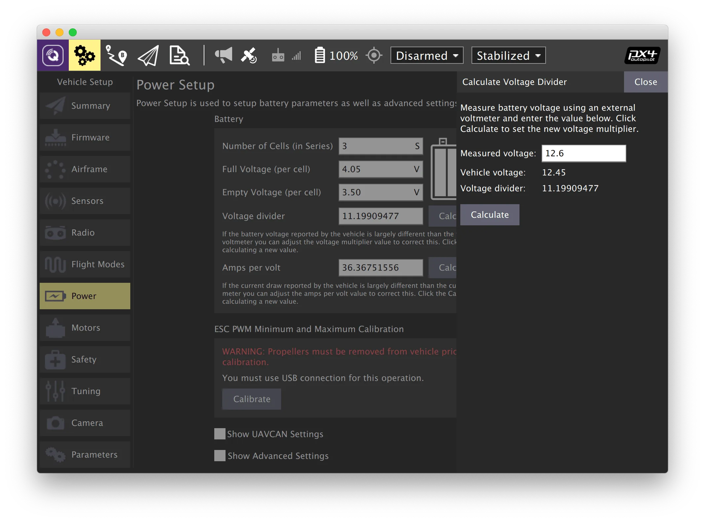

# Настройка питания

Чтобы откалибровать параметры, связанные с электропитанием, зайдите во вкладку *Vehicle Setup* и выберите меню *Power*.

## Калибровка делителя напряжения

> **Note** Калибровка делителя напряжения должна выполняться с подключенным АКБ.

1. В программе QGroundControl перейдите в панель *Vehicle Setup* и выберите меню *Power*.
2. Установите параметр *Number of cells* в соответствии с количеством банок в АКБ (*4S* для Клевера 4 или *6S* для Клевера 5).
3. Откалибруйте делитель напряжения:
   * Подключите индикатор напряжения к балансировочному разъему АКБ.
   * Нажмите кнопку *Calculate* напротив надписи *Voltage Divider*.
   * Введите в открывшемся поле суммарное значение напряжения с индикатора напряжения.
   * Нажмите *Close*, чтобы сохранить рассчитанное значение.

В случае отсутствия индикатора напряжения или невозможности ручной калибровки, установите усредненное значение делителя напряжения для комплекта Клевер 4 (*Voltage divider* = 11), для комплекта Клевер 5 (*Voltage divider* = 21).

Дополнительная информация: https://docs.qgroundcontrol.com/Stable_V5.1/en/qgc-user-guide/setup_view/power.html.

**Далее**: [настройка Failsafe](failsafe.md).
