# Настройка аппаратуры управления (Radio)

## Содержание
1. [Обзор аппаратуры](#обзор-аппаратуры)
2. [Настройка аппаратуры](#настройка-аппаратуры)
3. [Создание модели дрона](#создание-модели-дрона)
4. [Загрузка модели](#загрузка-модели)
5. [Сопряжение аппаратуры управления с приемником](#сопряжение-аппаратуры-управления-с-приемником)
6. [Сопряжение аппаратуры управления с приемником через Bind Phrase](#сопряжение-аппаратуры-управления-с-приемником-через-bind-phrase)

## Обзор аппаратуры

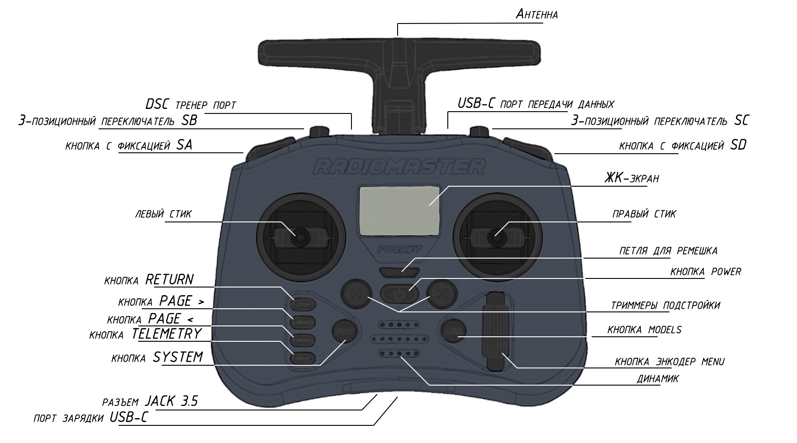

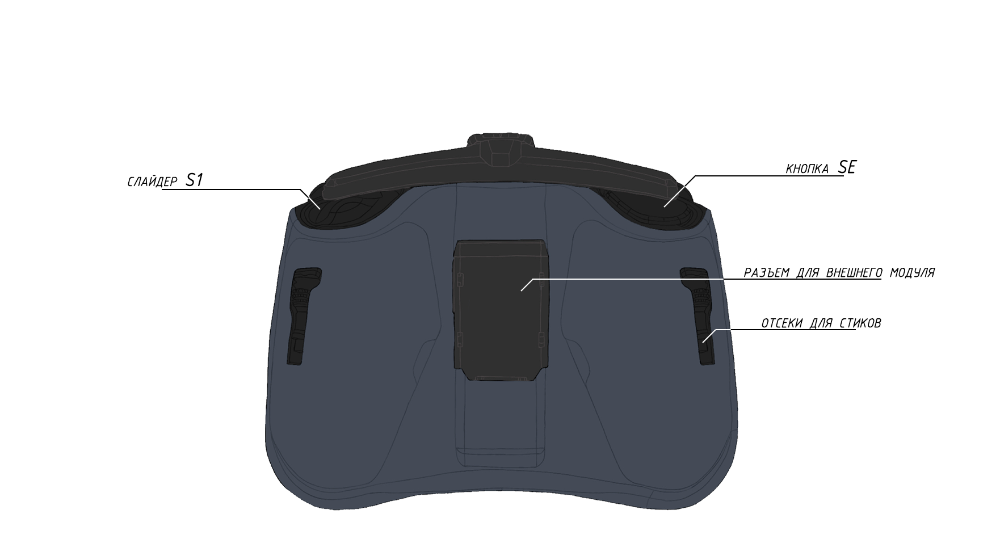

## Настройка аппаратуры

1. Снимите черные резиновые накладки с задней стороны аппаратуры управления.
2. Вставьте АКБ, соблюдая полярность.
3. Наденьте резиновые накладки обратно.
4. Включите аппаратуру, зажав кнопку **POWER**.

> **Caution** Если на экране аппаратуры появляются сообщения с предупреждением (картинка WARN), тогда проверьте положение тумблеров и стика газа (Throttle), они должны быть в нулевом положении.  

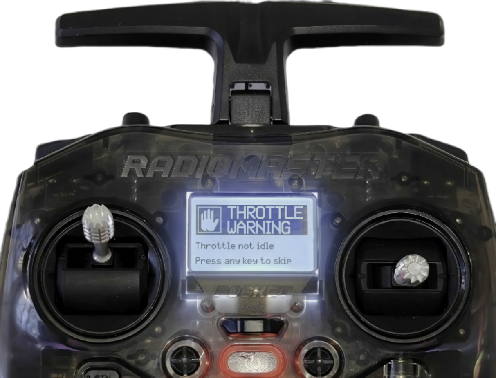

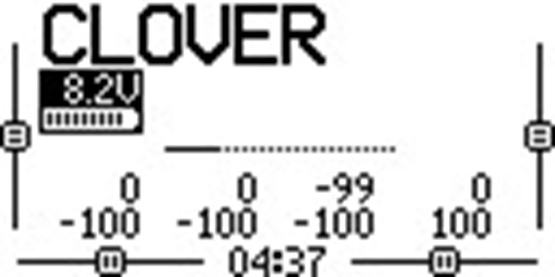

## Создание модели дрона

1. Нажмите кнопку **MDL**.
2. Выберите пустое поле и зажмите **колесо (энкодер)**.

    
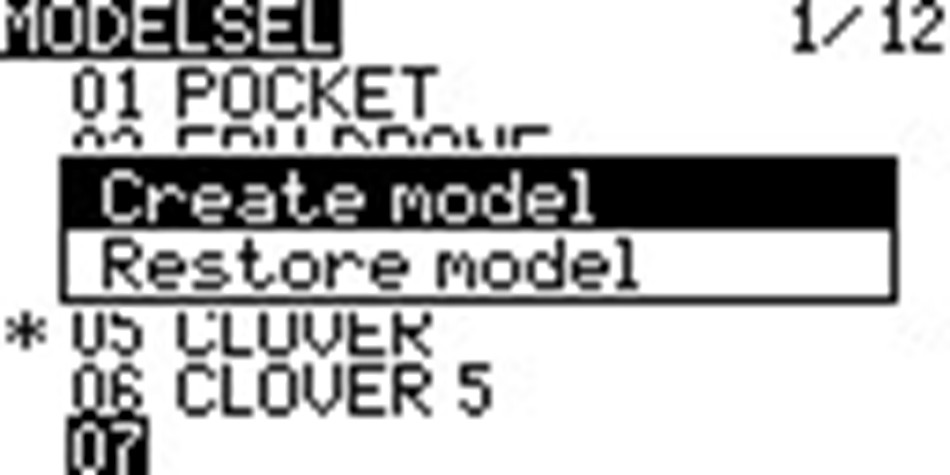

3. Выберите пункт **CREATE MODEL**.
4. Нажмите кнопку **PAGE >**.
5. С помощью **колеса (энкодера)** выберите пункт **«Model name»** и дайте имя вашему дрону.

    
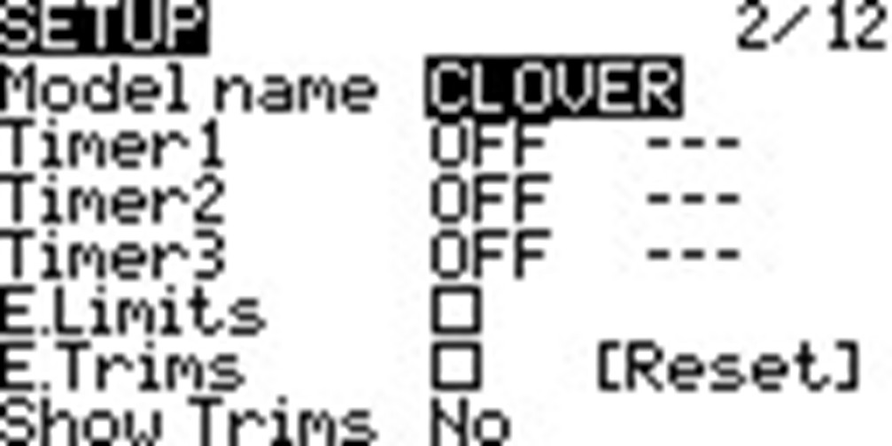

6. Вернитесь в меню с помощью кнопки **RTN**.
7. С помощью **колеса (энкодера)** спуститесь ниже и включите внутренний передатчик сигнала.

  

    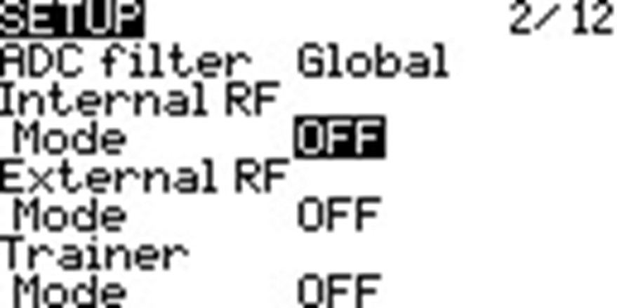
    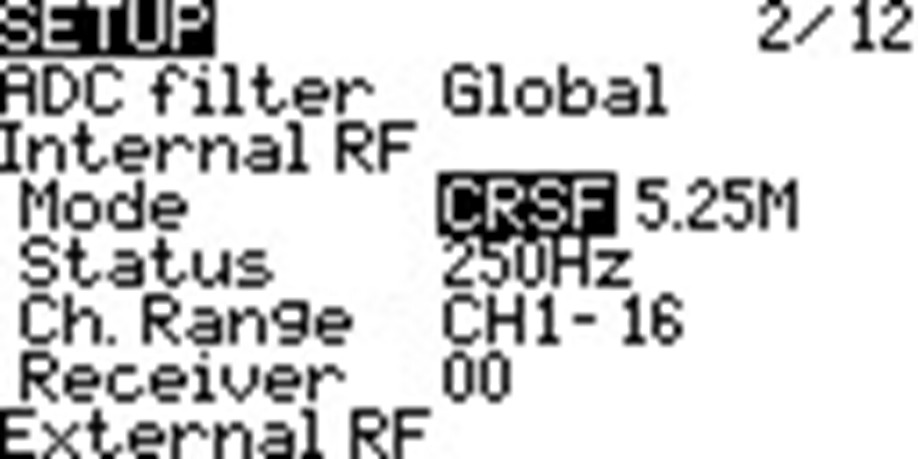
  

8. Перейдите на страницу **MIXES** и включите дополнительные свитчи на аппаратуре:

  

    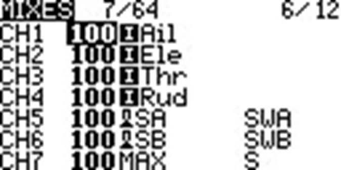
    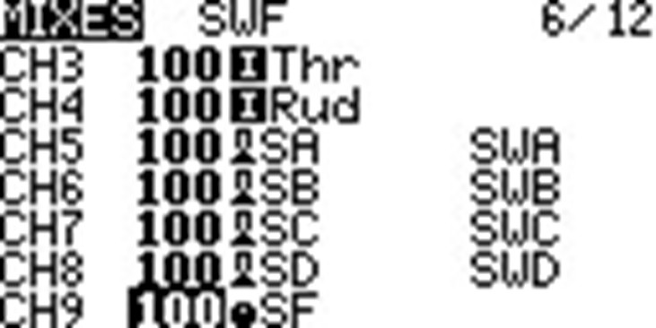
  

   
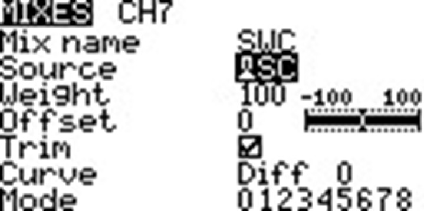

9. У вас должны быть настроены все свитчи от SA до S1, после чего нажмите кнопку **RTN**. На этом основная настройка модели дрона закончена.

## Загрузка модели

1. Скачайте файл модели дрона на ПК [`model05.yml`](https://drive.google.com/file/d/19Ab9sWPvaOvIavkEXPXzDXCRajpBcO7e/view?usp=sharing).
2. Включите аппаратуру > подключите кабель type-C в верхний USB порт > выберите в меню вариант подключения **USB Storage (SD)**.
3. В появившемся окне перейдите в папку **MODELS** и скопируйте в неё файл `model05.yml`.

    
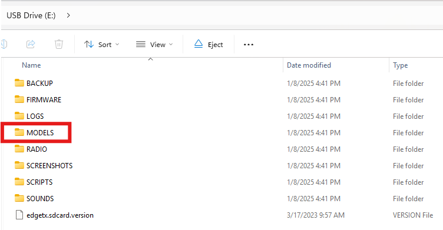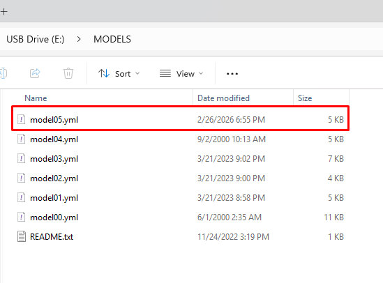

## Сопряжение аппаратуры управления с приемником

1. Переведите приемник в режим **bind**, трижды подключив и отключив питание полетного контроллера, к которому подключен приемник ELRS.

  > **Note** При переходе приемника в режим сопряжения, светодиод на приемнике начнет **мигать дважды с паузой**.

2. Нажмите кнопку **SYS** и перейдите в меню **ExpressLRS**.

    
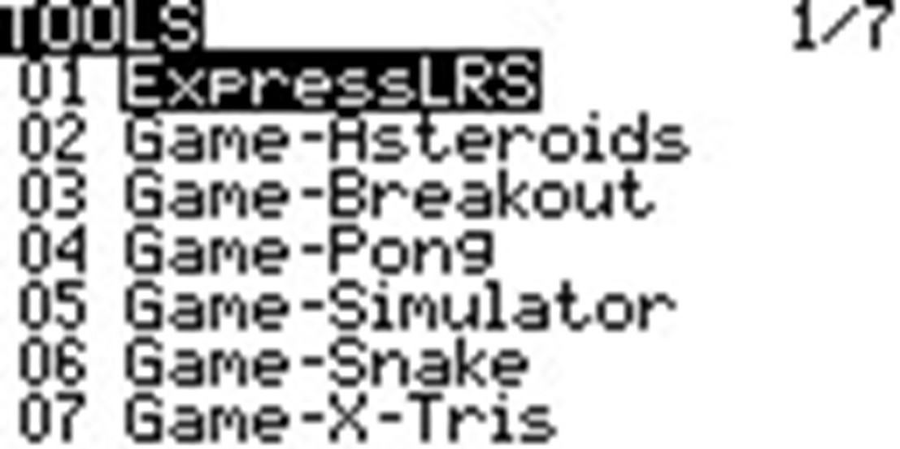

3. Выставьте **TX Power** на **100mW**.

    

4. Нажмите кнопку **bind**, дождитесь сопряжения.

    

5. После чего зажмите кнопку **RTN**, и в основном меню появится индикатор связи с приемником.

    
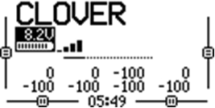

## Сопряжение аппаратуры управления с приемником через Bind Phrase

### Настройка аппаратуры (передатчика)

1. Включите аппаратуру, зажав кнопку **POWER**.
2. Нажмите кнопку **SYS** и перейдите в меню **ExpressLRS**.

    

3. Перейдите во вкладку **WiFi Connectivity** и активируйте подключение **Enable WiFi**.

  

    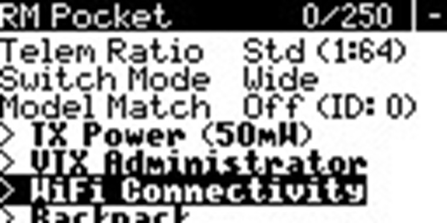
  

  

    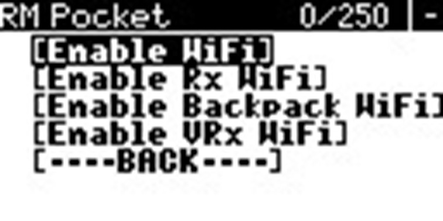
  

  

    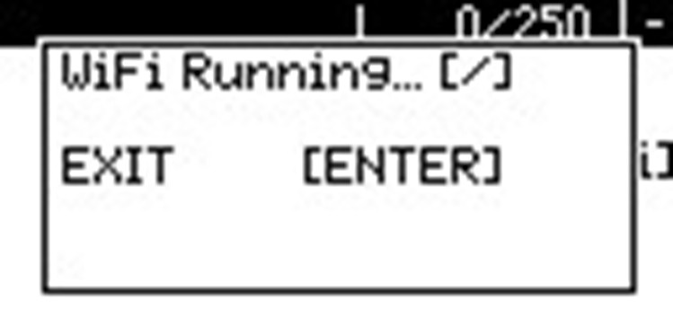
  

4. Подключитесь с компьютера или смартфона к появившейся сети **ExpressLRS TX**. Пароль по умолчанию: **expresslrs**.

    
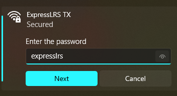

5. Откройте браузер и перейдите по адресу `10.0.0.1`.

    > **Note** **Обратите внимание на версию прошивки:** если она меньше 3.3.1, то её следует обновить через [ExpressLRS Web Flasher](https://expresslrs.github.io/web-flasher/).

    
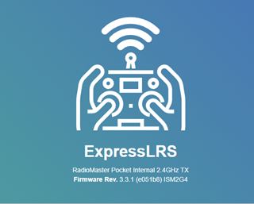

6. Введите уникальную **Binding Phrase** и нажмите **SAVE**.

    
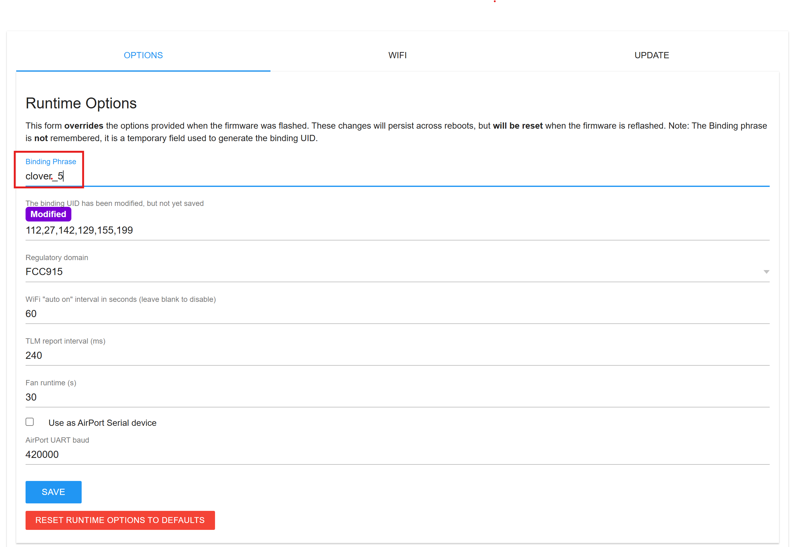

7. В появившемся окне нажмите кнопку **REBOOT**.

    
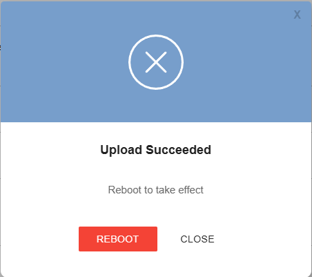

### Настройка приемника

1. Переведите приемник в режим **WiFi**, подав питание на полетный контроллер, к которому подключен приемник ELRS и подождав 60 секунд, после чего приемник будет непрерывно моргать.

2. Подключитесь с компьютера или смартфона к появившейся сети **ExpressLRS RX**. Пароль по умолчанию: **expresslrs**.

    
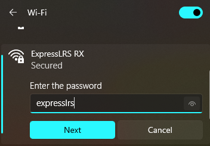

3. Откройте браузер и перейдите по адресу `10.0.0.1`.

    > **Note** **Обратите внимание** на версию прошивки: если она меньше 3.0.0, то её следует обновить через ["ExpressLRS Web Flasher"](https://expresslrs.github.io/web-flasher/).

    
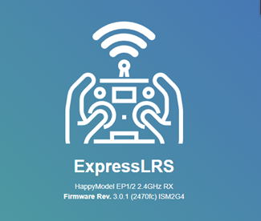

4. Введите **ТАКУЮ ЖЕ** уникальную **Binding Phrase**, как и на передатчике, и нажмите **SAVE & REBOOT**.

    
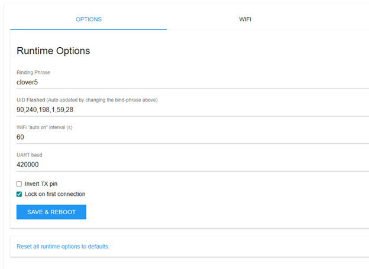

5. В появившемся окне нажмите кнопку **REBOOT**.

    

6. Настройка завершена.

    

