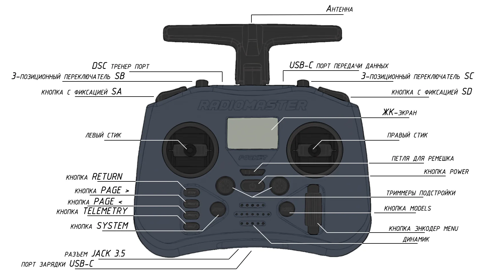
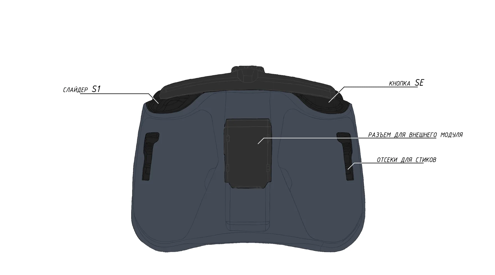
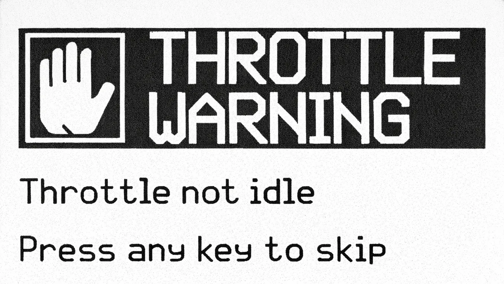
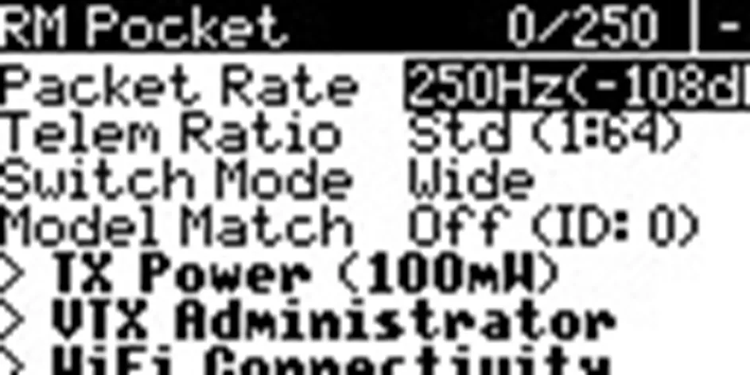
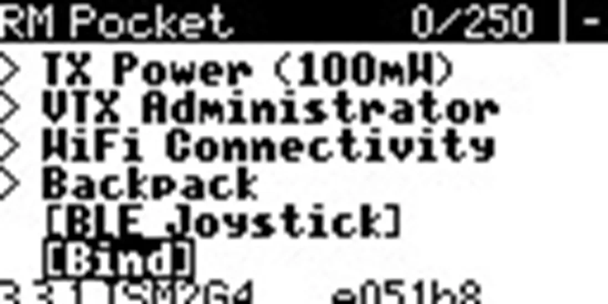
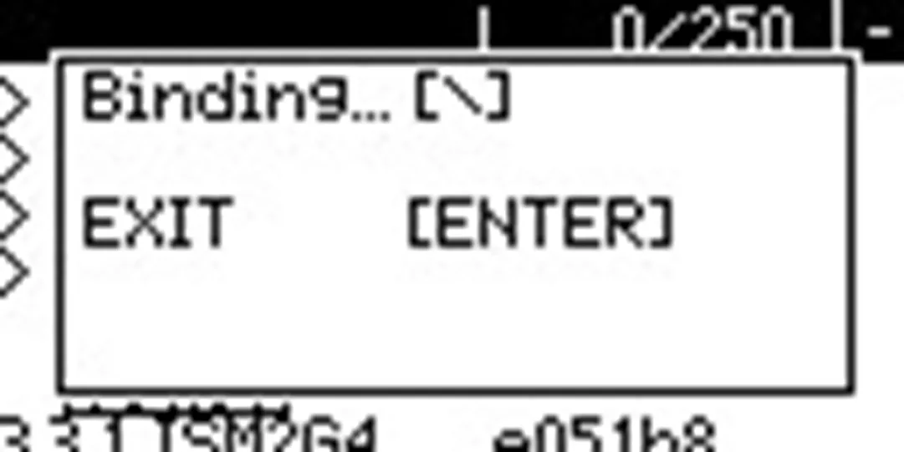

# Настройка аппаратуры управления (Radio)

## Содержание
1. [Обзор аппаратуры](#обзор-аппаратуры)
2. [Настройка аппаратуры](#настройка-аппаратуры)
3. [Сопряжение аппаратуры управления с приемником](#сопряжение-аппаратуры-управления-с-приемником)

## Обзор аппаратуры

Рисунок 1 – Аппаратура управления, вид спереди

Рисунок 2 – Аппаратура управления, вид сзади

## Настройка аппаратуры

1. Снимите черные резиновые накладки с задней стороны аппаратуры управления.
2. Вставьте АКБ, соблюдая полярность.
3. Наденьте резиновые накладки обратно.
4. Включите аппаратуру, зажав кнопку **POWER**.

> **Caution** Если на экране аппаратуры появляются предупреждения, проверьте положение тумблеров и стика газа (Throttle). Перед включением они должны быть в нулевом положении.

Рисунок 3 – Предупреждение при неверном положении стиков или тумблеров

После установки тумблеров и стиков в нулевое положение вы попадете в главное меню.

Рисунок 4 – Главное меню аппаратуры без связи с приемником

## Сопряжение аппаратуры управления с приемником

1. Переведите приемник в режим **bind**, трижды подключив и отключив питание полетного контроллера, к которому подключен приемник ELRS.

> **Note** При переходе приемника в режим сопряжения светодиод на приемнике начнет мигать дважды с паузой.

2. На аппаратуре нажмите кнопку **SYS** и перейдите в меню **ExpressLRS**, как показано на рисунке 5.

Рисунок 5 – Переход в меню ExpressLRS

3. Установите **TX Power** в значение **100mW**, как показано на рисунке 6.

Рисунок 6 – Установка мощности передатчика 100mW

4. Нажмите кнопку **Bind** и дождитесь завершения сопряжения, как показано на рисунке 7.

Рисунок 7 – Запуск сопряжения в меню ExpressLRS

5. Нажмите кнопку **RTN**. В основном меню появится индикатор связи с приемником, как на рисунке 8.

Рисунок 8 – Главное меню аппаратуры после успешного сопряжения

> **Success** [Подробная настройка пульта](radio_full.md) доступна в отдельной документации.