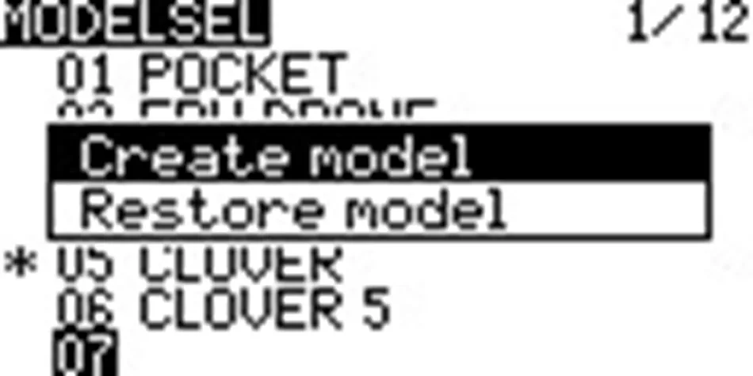
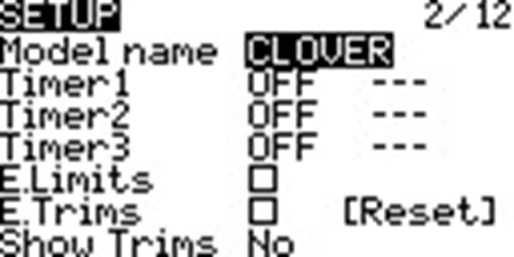
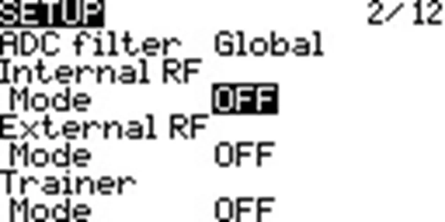
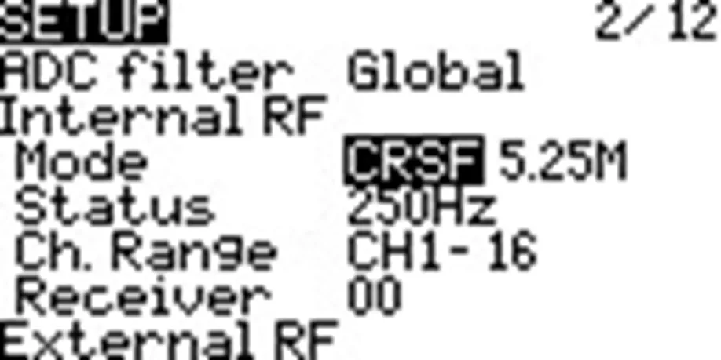
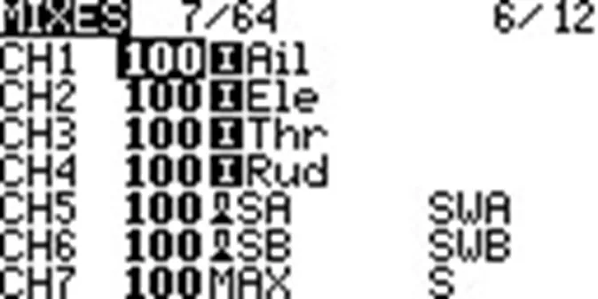
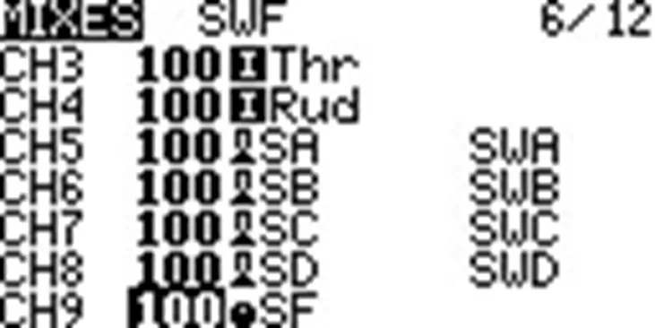
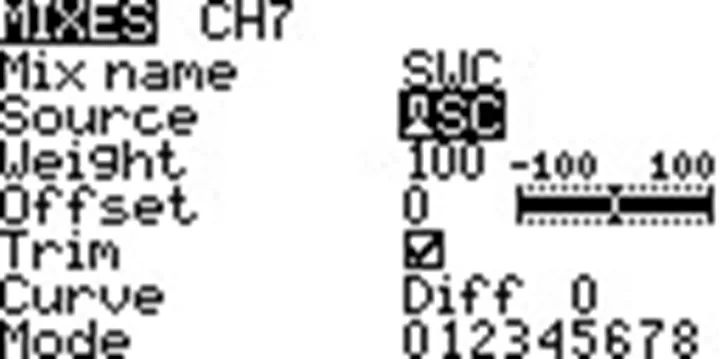
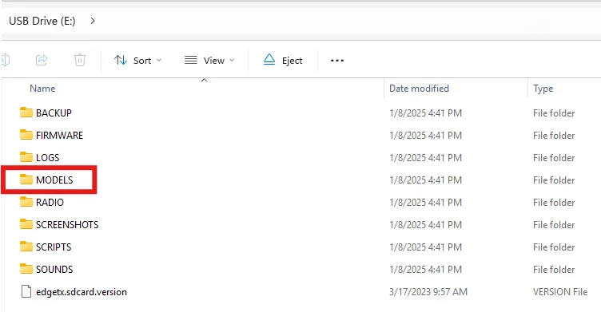
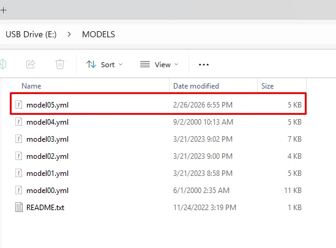

# Подробная настройка аппаратуры управления (Radio)

## Содержание
1. [Обзор аппаратуры](#обзор-аппаратуры)
2. [Настройка аппаратуры](#настройка-аппаратуры)
3. [Создание модели дрона](#создание-модели-дрона)
4. [Загрузка модели](#загрузка-модели)
5. [Сопряжение аппаратуры управления с приемником через Bind Phrase](#сопряжение-аппаратуры-управления-с-приемником-через-bind-phrase)
6. [Сопряжение аппаратуры управления с приемником](#сопряжение-аппаратуры-управления-с-приемником)

## Обзор аппаратуры

Рисунок 1 – Аппаратура управления, вид спереди

Рисунок 2 – Аппаратура управления, вид сзади

## Настройка аппаратуры

1. Снимите черные резиновые накладки с задней стороны аппаратуры управления.
2. Вставьте АКБ, соблюдая полярность.
3. Наденьте резиновые накладки обратно.
4. Включите аппаратуру, зажав кнопку **POWER**.

> **Caution** Если на экране аппаратуры появляются сообщения с предупреждением (картинка WARN), тогда проверьте положение тумблеров и стика газа (Throttle), они должны быть в нулевом положении.  

Рисунок 3 – Предупреждение при неверном положении стиков или тумблеров

После установки тумблеров и стиков в нулевое положение вы попадете в главное меню.

Рисунок 4 – Главное меню аппаратуры без связи с приемником

## Создание модели дрона

1. Нажмите кнопку **MDL**.
2. Выберите пустое поле и зажмите **колесо (энкодер)**, как показано на рисунке 5.

    

Рисунок 5 – Выбор пустой модели

3. Выберите пункт **CREATE MODEL**.
4. Нажмите кнопку **PAGE >**.
5. С помощью **колеса (энкодера)** выберите пункт **«Model name»** и дайте имя вашему дрону, как показано на рисунке 6.

    

Рисунок 6 – Задание имени модели

6. Вернитесь в меню с помощью кнопки **RTN**.
7. С помощью **колеса (энкодера)** спуститесь ниже и включите внутренний передатчик сигнала, как показано на рисунке 7.

  

    
    
    
Рисунок 7 – Включение внутреннего передатчика сигнала

  

8. Перейдите на страницу **MIXES** и включите дополнительные свитчи на аппаратуре, как показано на рисунках 8 и 9:

  

    
    
    
Рисунок 8 – Настройка дополнительных свитчей в меню MIXES

  

   

Рисунок 9 – Экран со списком настроенных свитчей

9. У вас должны быть настроены все свитчи от SA до S1, после чего нажмите кнопку **RTN**. На этом основная настройка модели дрона закончена.

## Загрузка модели

1. Скачайте файл модели дрона на ПК [`model05.yml`](https://drive.google.com/file/d/19Ab9sWPvaOvIavkEXPXzDXCRajpBcO7e/view?usp=sharing).
2. Включите аппаратуру > подключите кабель type-C в верхний USB порт > выберите в меню вариант подключения **USB Storage (SD)**.
3. В появившемся окне перейдите в папку **MODELS** и скопируйте в неё файл `model05.yml`, как показано на рисунке 10.

    

Рисунок 10 – Копирование файла модели в папку MODELS

## Сопряжение аппаратуры управления с приемником через Bind Phrase

### Настройка аппаратуры (передатчика)

1. Включите аппаратуру, зажав кнопку **POWER**.
2. Нажмите кнопку **SYS** и перейдите в меню **ExpressLRS**, как показано на рисунке 11.

    

Рисунок 11 – Переход в меню ExpressLRS для настройки передатчика

3. Перейдите во вкладку **WiFi Connectivity** и активируйте подключение **Enable WiFi**, как показано на рисунках 12 и 13.

  

    
  

  

    
  

  

    
    
Рисунок 12 – Переход к настройкам WiFi Connectivity

    
Рисунок 13 – Включение WiFi на передатчике ExpressLRS

  

4. Подключитесь с компьютера или смартфона к появившейся сети **ExpressLRS TX**. Пароль по умолчанию: **expresslrs**. Пример подключения показан на рисунке 14.

    

Рисунок 14 – Подключение к сети ExpressLRS TX

5. Откройте браузер и перейдите по адресу `10.0.0.1`. Стартовый экран показан на рисунке 15.

    > **Note** **Обратите внимание на версию прошивки:** если она меньше 3.3.1, то её следует обновить через [ExpressLRS Web Flasher](https://expresslrs.github.io/web-flasher/).

    

Рисунок 15 – Веб-интерфейс передатчика ExpressLRS

6. Введите уникальную **Binding Phrase** и нажмите **SAVE**, как показано на рисунке 16.

    

Рисунок 16 – Ввод Binding Phrase в настройках передатчика

7. В появившемся окне нажмите кнопку **REBOOT**, как показано на рисунке 17.

    

Рисунок 17 – Перезагрузка передатчика после сохранения настроек

### Настройка приемника

1. Переведите приемник в режим **WiFi**, подав питание на полетный контроллер, к которому подключен приемник ELRS и подождав 60 секунд, после чего приемник будет непрерывно моргать.

2. Подключитесь с компьютера или смартфона к появившейся сети **ExpressLRS RX**. Пароль по умолчанию: **expresslrs**. Пример подключения показан на рисунке 18.

    

Рисунок 18 – Подключение к сети ExpressLRS RX

3. Откройте браузер и перейдите по адресу `10.0.0.1`. Стартовый экран показан на рисунке 19.

    > **Note** **Обратите внимание** на версию прошивки: если она меньше 3.0.0, то её следует обновить через ["ExpressLRS Web Flasher"](https://expresslrs.github.io/web-flasher/).

    

Рисунок 19 – Веб-интерфейс приемника ExpressLRS

4. Введите **ТАКУЮ ЖЕ** уникальную **Binding Phrase**, как и на передатчике, и нажмите **SAVE & REBOOT**, как показано на рисунке 20.

    

Рисунок 20 – Ввод Binding Phrase в настройках приемника

5. В появившемся окне нажмите кнопку **REBOOT**, как показано на рисунке 21.

    

Рисунок 21 – Перезагрузка приемника после сохранения настроек

6. Настройка завершена. После перезагрузки связь должна появиться, как на рисунке 22.

    

Рисунок 22 – Главное меню аппаратуры после настройки через Bind Phrase

## Сопряжение аппаратуры управления с приемником

Альтернативный способ — сопряжение через режим **bind** приемника.

1. Переведите приемник в режим **bind**, трижды подключив и отключив питание полетного контроллера, к которому подключен приемник ELRS.

  > **Note** При переходе приемника в режим сопряжения, светодиод на приемнике начнет **мигать дважды с паузой**.

2. Нажмите кнопку **SYS** и перейдите в меню **ExpressLRS**, как показано на рисунке 23.

    

Рисунок 23 – Переход в меню ExpressLRS

3. Выставьте **TX Power** на **100mW**, как показано на рисунке 24.

    

Рисунок 24 – Установка мощности передатчика 100mW

4. Нажмите кнопку **bind**, дождитесь сопряжения, как показано на рисунке 25.

    

Рисунок 25 – Запуск сопряжения в меню ExpressLRS

5. После чего зажмите кнопку **RTN**, и в основном меню появится индикатор связи с приемником, как на рисунке 26.

    

Рисунок 26 – Главное меню аппаратуры после успешного сопряжения

